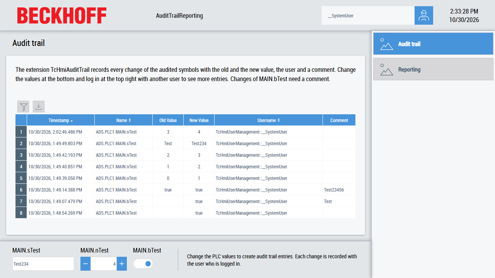
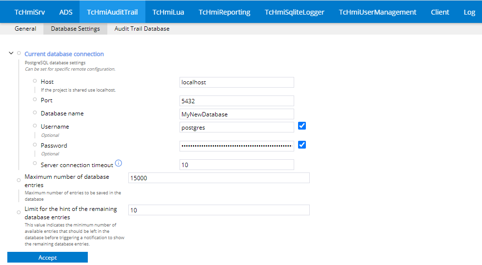
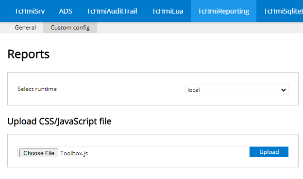
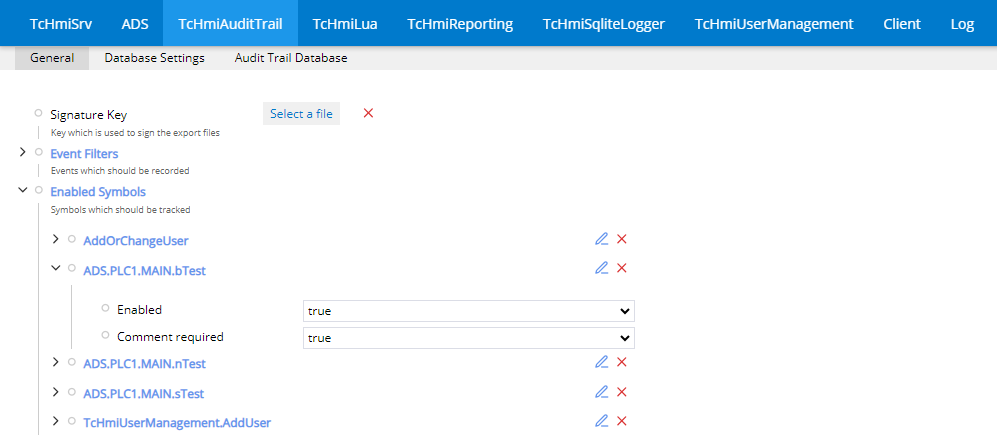
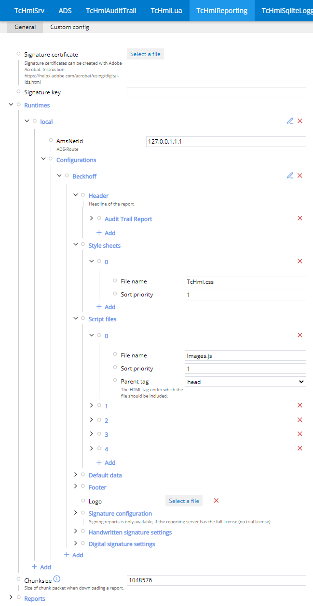
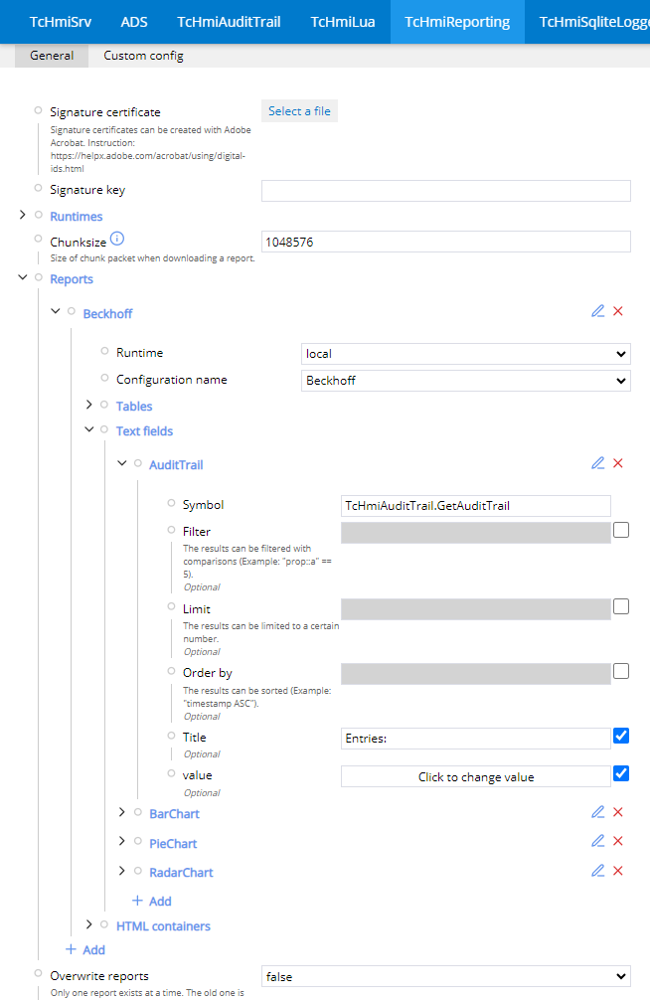
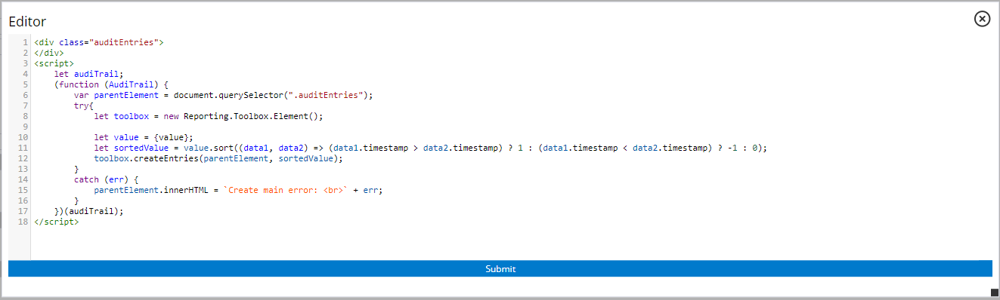

# AuditTrailReporting

This sample shows how to record changes of symbols with the TcHmiAuditTrail extension and how to create a report of these changes with the TcHmiReporting extension.



## Running the sample

To run the sample you need:

- The PLC of `AuditTrailReporting_XAE`, activated and running.
- A PostgreSQL server for the audit trail, see [Set up the database](#set-up-the-database).
- The TwinCAT Reporting Server for the reports, see [Set up the reporting server](#set-up-the-reporting-server).

Then run the sample:

1. Install PostgreSQL and create the database, see [Set up the database](#set-up-the-database). Install the TwinCAT Reporting Server, see [Set up the reporting server](#set-up-the-reporting-server).
2. Open [AuditTrailReporting.sln](AuditTrailReporting.sln) in Visual Studio or the TwinCAT XAE Shell with TwinCAT HMI Engineering installed.
3. Activate the configuration of `AuditTrailReporting_XAE` and start the PLC.
4. Restore the NuGet packages, build the solution and start the Live-View of `AuditTrailReporting_HMI`.
5. On the Config page, enter the database password. Upload the three reporting files once with `Upload files` on the page `Reporting`.
6. Change the values at the bottom and watch the entries on the page `Audit trail`. Then click `Create report` on the page `Reporting`.

### Set up the database

The sample is configured for a local PostgreSQL server: host `localhost`, port `5432`, database `MyNewDatabase`, user `postgres`. If you set it up with these values, you only enter the password in the HMI.

1. Install PostgreSQL, for example with the Windows installer from [postgresql.org](https://www.postgresql.org/download/windows/). Keep the components PostgreSQL Server, pgAdmin 4 and Command Line Tools, Stack Builder is not needed. Set a password for the database superuser `postgres` and keep the port `5432`.
2. Open pgAdmin 4, connect to the PostgreSQL server with this password and create the database `MyNewDatabase`: right-click Databases, Create, Database. On the command line, `psql -U postgres -c "CREATE DATABASE \"MyNewDatabase\";"` does the same. The inner quotes are needed because of the capital letters.
3. Start the Live-View of `AuditTrailReporting_HMI` and open the Config page of the server. Under TcHmiAuditTrail, Database settings, host, port, database and user are already filled in. Enter the password of `postgres` and accept.
4. Diagnostics of TcHmiAuditTrail shows `PostgreSQL System Connected` as connection state. The extension creates its tables in the database by itself.



### Set up the reporting server

Do these steps once before the first report:

1. Install the TwinCAT Reporting Server, the package `TwinCAT.XAR.ReportingServer`, with the TwinCAT Package Manager or on the command line:

   ```cmd
   tcpkg install TwinCAT.XAR.ReportingServer
   ```

   Without it, creating a report fails with `Target port could not be found. (AdsErrorCode: 6, 0x6)`.
2. Upload the three files of [ReportingSources](AuditTrailReporting_HMI/ReportingSources) to the runtime `local`. Without them, the report shows `ReferenceError: Reporting is not defined` instead of the entries. There are two ways:
   - Start the Live-View of `AuditTrailReporting_HMI` and click `Upload files` on the page `Reporting`, below step 1.
   - Or open the Config page of the server, go to TcHmiReporting, Custom config, select the runtime `local`, then select each file under `Upload CSS/JavaScript file` and upload it.



## Overview

The solution contains two projects:

| Project                                            | Content                                                                       |
| -------------------------------------------------- | ----------------------------------------------------------------------------- |
| [AuditTrailReporting_HMI](AuditTrailReporting_HMI) | The HMI project with the audit trail and the reporting server extensions.     |
| [AuditTrailReporting_XAE](AuditTrailReporting_XAE) | A PLC with the audited variables `MAIN.sTest`, `MAIN.nTest` and `MAIN.bTest`. |

[Desktop.view](AuditTrailReporting_HMI/Desktop.view) uses the layout of the TwinCAT HMI BaseTemplate from the `Beckhoff.TwinCAT.HMI.BaseTemplate` package: a header at the top, a navigation on the right, a region for the pages in the center and a container at the bottom. The header contains the user management, so you can log in with another user. The container at the bottom changes the three PLC variables to create audit trail entries.

The page [Audit trail](AuditTrailReporting_HMI/Pages/AuditTrail.content) shows the recorded changes. The page [Reporting](AuditTrailReporting_HMI/Pages/Reporting.content) explains the configuration of the report with code excerpts and creates the report with a button next to them.

## Audit trail

The page `Audit trail` shows the entries in the grid `TcHmiAuditTrailGrid` of the `Beckhoff.TwinCAT.HMI.AuditTrailUtils` package: when a symbol changed, its old and new value, the user who changed it and the comment.

### Audited symbols

The tab General lists the audited symbols and events. In this sample these are the three PLC variables and the symbols of the user management, for example `TcHmiUserManagement.AddUser`. `MAIN.bTest` requires a comment: before the new value is written, the HMI asks for a comment with at least 5 characters, which is stored with the entry.



## Reporting

The page `Reporting` explains the four steps of the report with code excerpts on the left and creates the report on the right. The extension TcHmiReporting creates the report with the TwinCAT Reporting Server.

### Scripts and stylesheet

The report uses the uploaded files:

- [Toolbox.js](AuditTrailReporting_HMI/ReportingSources/ReportingScripts/Toolbox.js) creates the entries of the report.
- [Images.js](AuditTrailReporting_HMI/ReportingSources/ReportingScripts/Images.js) contains the icons of the entries.
- [TcHmi.css](AuditTrailReporting_HMI/ReportingSources/ReportingStyles/TcHmi.css) defines the layout of the entries.

The button `Upload files` calls the function [UploadReportingSources](AuditTrailReporting_HMI/ReportingFunctions/UploadReportingSources.ts). It loads the three files from the HMI server and writes each of them to the function symbol `TcHmiReporting.AddResource`, like the upload on the Config page:

```ts
{ name: 'Toolbox', data: '<content of Toolbox.js>', type: 1, runtime: 'local' }
```

`name` is the file name without extension, `type` is `0` for CSS and `1` for JavaScript. The function returns a short text, which the button writes to the text next to it.

### Runtime and report

The runtime `local` and the report `Beckhoff` are already configured in the sample. A runtime defines the ADS route to the reporting server and the configuration of the report: among other things the header, the footer and the sources, including the uploaded files. Each file has to be listed there.



A report under `Reports` refers to a runtime and its configuration and defines `Tables`, `Text fields` and `HTML containers`. Each of them reads a symbol which provides its data. In the report of this sample, the text field `AuditTrail` reads the symbol `TcHmiAuditTrail.GetAuditTrail`, the text fields `BarChart`, `PieChart` and `RadarChart` add charts.



The `value` of a text field is HTML. It can contain scripts, so the report can use the uploaded files. `{value}` is replaced by the data of the symbol when the report is created. Click `value` of the text field to edit it:



This value creates the list of audit trail entries:

```html
<div class="auditEntries">
</div>
<script>
    let audiTrail;
    (function (AudiTrail) {
        var parentElement = document.querySelector(".auditEntries");
        try{
          let toolbox = new Reporting.Toolbox.Element();

          // The value will be replaced while loading.
          let jsValue = {value};
          let sortedValue = jsValue.sort((data1, data2) => (data1.timestamp > data2.timestamp) ? 1 : (data1.timestamp < data2.timestamp) ? -1 : 0);
          toolbox.createEntries(parentElement, sortedValue);
        }
        catch (err) {
          parentElement.innerHTML = `Create main error: <br>` + err;
        }
    })(audiTrail);
</script>
```

### Create a report

The button `Create report` first clears the PDF viewer and then writes the name of the report to the function symbol `TcHmiReporting.OrderReport`:

```json
{
  "objectType": "WriteToSymbol",
  "symbolExpression": "%s%TcHmiReporting.OrderReport%/s%",
  "value": { "objectType": "StaticValue", "valueType": "tchmi:general#/definitions/String", "value": "Beckhoff" }
}
```

The extension stores the PDF in the folder `reports` of its extension directory. The virtual directory `/TcHmiReporting` in the configuration of the server (TcHmiSrv, Virtual directories) maps this folder to the URL `/TcHmiReporting/reports/Beckhoff.pdf`. In the sample it points to the extension directory of the Engineering server, `.engineering_servers\AuditTrailReporting_HMI\TcHmiReporting`. `overwriteReports` is set in the configuration of TcHmiReporting, so there is only one file per report, which a new report overwrites.

The `TcHmiPdfViewer` of the `Beckhoff.TwinCAT.HMI.PDFViewer` package shows the report. Its trigger reads `TcHmiReporting.Diagnostics::reportsInProgress`: when the button set the internal symbol `ReportOrdered` and no report is in progress anymore, it loads the PDF again. A timestamp in the URL prevents that the browser shows the old report from its cache.

The Config page can create reports as well: under TcHmiReporting, Custom config, select the runtime `local` and the report `Beckhoff` and click `Create`.
