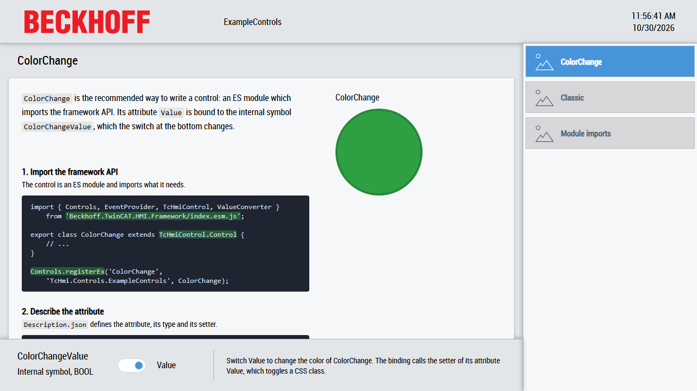

# ExampleControls

This sample shows how to create own controls in a package project and how to use them in an HMI project: the recommended way with ES modules, the classic way with the global `TcHmi` namespace, the different kinds of module imports and unit tests for a control.

## Running the sample

1. Open [ExampleControls.sln](ExampleControls.sln) in Visual Studio or the TwinCAT XAE Shell with TwinCAT HMI Engineering installed.
2. Restore the NuGet packages, build the solution and start the Live-View of the `HMI` project.
3. Switch Value at the bottom and watch the color of the controls on the pages `ColorChange` and `Classic`. Open the page `Module imports` to see the imported values.

## Overview

The solution contains three projects:

| Project                            | Content                                         |
| ---------------------------------- | ----------------------------------------------- |
| [ExampleControls](ExampleControls) | Package project with the four example controls. |
| [HMI](HMI)                         | HMI project which uses the controls.            |
| [UnitTests](UnitTests)             | Unit tests for the control `ColorChange`.       |

The package contains these controls:

| Control                                                  | Shows                                                                                 |
| -------------------------------------------------------- | ------------------------------------------------------------------------------------- |
| [ColorChange](ExampleControls/ColorChange)               | The recommended way: an ES module with an attribute, which imports the framework API. |
| [ColorChangeClassic](ExampleControls/ColorChangeClassic) | The same control the classic way: a TypeScript namespace with the global `TcHmi` API. |
| [ModuleImports](ExampleControls/ModuleImports)           | The different kinds of module imports in TypeScript.                                  |
| [ModuleImportsJs](ExampleControls/ModuleImportsJs)       | The same imports in plain JavaScript, without TypeScript.                             |

[Desktop.view](HMI/Desktop.view) uses the layout of the TwinCAT HMI BaseTemplate from the `Beckhoff.TwinCAT.HMI.BaseTemplate` package: a header at the top, a navigation on the right, a region for the pages in the center and a container at the bottom. The pages `ColorChange`, `Classic` and `Module imports` explain the controls with code excerpts. The switch at the bottom changes the internal symbol `ColorChangeValue`, which is bound to the attribute `Value` of `ColorChange` and `ColorChangeClassic`.

## A control with an attribute

`ColorChange` shows a circle whose color depends on its boolean attribute `Value`:

1. [ColorChange.ts](ExampleControls/ColorChange/ColorChange.ts) is an ES module. It imports the framework API (`TcHmiControl`, `Controls`, `ValueConverter`, `EventProvider`) from `Beckhoff.TwinCAT.HMI.Framework/index.esm.js` and registers the control with `Controls.registerEx`. [Description.json](ExampleControls/ColorChange/Description.json) lists `ColorChange.js` with the type `EsModule`.
2. `Description.json` defines the attribute `data-tchmi-value` in the property `attributes`, with its type, its default value and the names of its setter and getter.
3. The setter `setValue` converts the new value with `ValueConverter.toBoolean` and returns if it did not change. Otherwise it stores the value, raises `onPropertyChanged`, so bindings which read the attribute are updated, and calls `__processValue`. The getter `getValue` returns the stored value.
4. `__processValue` toggles the [HTML classes](https://developer.mozilla.org/en-US/docs/Web/HTML/Global_attributes/class) `glow-green` and `glow-red` on the circle element.
5. The [CSS](https://developer.mozilla.org/en-US/docs/Web/CSS) files of the themes [Base](ExampleControls/ColorChange/Themes/Base/Style.css) and [Base-Dark](ExampleControls/ColorChange/Themes/Base-Dark/Style.css) define the colors of these classes. The theme independent [Style.css](ExampleControls/ColorChange/Style.css) defines the shape and fades between the colors.

## The classic way

Before ES modules, controls were written as TypeScript namespaces which use the global `TcHmi` object. Such controls keep working, but new controls should be ES modules. [ColorChangeClassic](ExampleControls/ColorChangeClassic) is `ColorChange` written this way:

| Topic         | ColorChange                                                                         | ColorChangeClassic                                                                                              |
| ------------- | ----------------------------------------------------------------------------------- | --------------------------------------------------------------------------------------------------------------- |
| Code          | ES module, `export class ColorChange`                                               | `namespace TcHmi.Controls.ExampleControls { export class ... }`                                                 |
| Framework API | `import { ValueConverter, ... } from 'Beckhoff.TwinCAT.HMI.Framework/index.esm.js'` | Global `TcHmi.ValueConverter`, `TcHmi.EventProvider`, ...                                                       |
| Base class    | `TcHmiControl.Control`                                                              | `TcHmi.Controls.System.TcHmiControl`                                                                            |
| Registration  | `Controls.registerEx(..., ColorChange)`                                             | `TcHmi.Controls.registerEx(..., TcHmi.Controls.ExampleControls.ColorChangeClassic)`                             |
| Compilation   | [tsconfig.json](ExampleControls/tsconfig.json) of the package, `"module": "es2022"` | Own [tsconfig.json](ExampleControls/ColorChangeClassic/tsconfig.json) in the control folder, `"module": "none"` |
| Loading       | `Description.json`: type `EsModule`                                                 | `Description.json`: type `JavaScript`                                                                           |

A project can contain several `tsconfig.json` files: TwinCAT HMI Engineering adds each TypeScript file to the nearest `tsconfig.tpl.json` and `tsconfig.json` in its folder or above. The page `Classic` shows `ColorChangeClassic` and compares its code with `ColorChange`.

## Module imports

`ModuleImports` and `ModuleImportsJs` are the same control, written in TypeScript and in JavaScript. Both show the values they import. The comments in [ModuleImports.ts](ExampleControls/ModuleImports/ModuleImports.ts) and [ModuleImportsJs.js](ExampleControls/ModuleImportsJs/ModuleImportsJs.js) explain each import in detail.

- **Relative path**: `import { randomNumber, badNamedNumber as betterName } from "./someNumbers.js";` imports named values, renamed or not, and `import defaultNumber from "./someNumbers.js";` the default export. The path ends with `.js`, because the browser loads the compiled JavaScript file.
- **Bare module name**: `import { TcHmiShortName } from "textmodule";` uses a name instead of a path. The property `esmoduleImports` in [Manifest.json](ExampleControls/Manifest.json) maps the name to a file for the browser (an [import map](https://developer.mozilla.org/en-US/docs/Web/HTML/Element/script/type/importmap)), per control with `moduleScope` for `ModuleImportsJs`. For TypeScript, `paths` in `tsconfig.json` and `tsconfig.tpl.json` map the same name.
- **Framework API**: `import { TcHmiControl, Controls } from "Beckhoff.TwinCAT.HMI.Framework/index.esm.js";` imports the API of the framework in `ModuleImports.ts`. The names of all packages are added to the import map automatically. `ModuleImportsJs.js` uses the global `TcHmi` object instead, for example `extends TcHmi.Controls.System.TcHmiControl`: for plain JavaScript, Visual Studio reads no `tsconfig.json` or `jsconfig.json`, so IntelliSense only knows the global `TcHmi` object from `TcHmi.d.ts` and nothing about the imports.

Only the main file of a control is listed in the `dependencyFiles` of its `Description.json` with the type `EsModule`. The browser loads the imported files by itself.

The HMI project can import from the modules of a package as well: [usesPackageImport.ts](HMI/usesPackageImport.ts) imports a number from `ExampleControls/ModuleImports/someNumbers.js` with the package name as path and writes it to the console of the browser. The path is mapped in [tsconfig.json](HMI/tsconfig.json) for TypeScript; the browser gets the package names in its import map automatically.

## Unit tests

[UnitTests](UnitTests) tests `ColorChange` in the browser with Jasmine. Its [README](UnitTests/README.md) describes how to install and run the tests.

## Further information

- [Controls](https://infosys.beckhoff.com/content/1033/te2000_tc3_hmi_engineering/8971583499.html?id=6326028457938979673) (documentation in Infosys)
