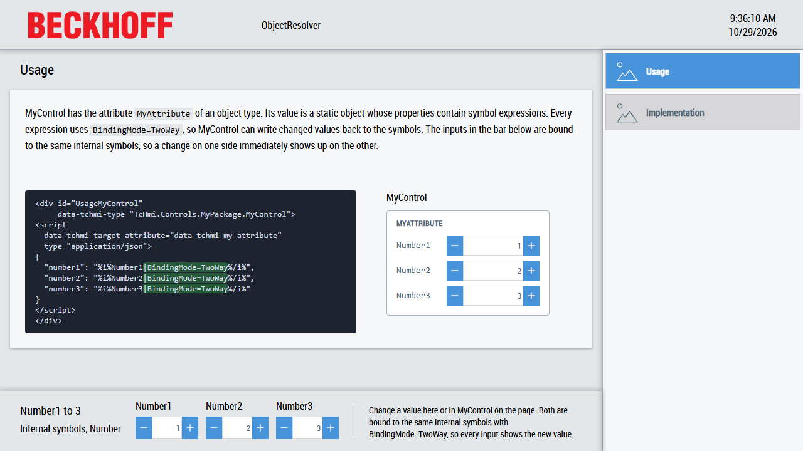

# ObjectResolver

This sample shows how a control uses the `TcHmi.ObjectResolver` class to resolve symbol expressions inside the object value of an attribute and how it writes changes of the object back to the symbols behind those expressions.



The solution contains two projects:

| Project                | Content                                                                                                       |
| ---------------------- | ------------------------------------------------------------------------------------------------------------- |
| [MyPackage](MyPackage) | A framework project with the control `MyControl`. It shows the three values of its attribute in spinboxes.    |
| [HMI](HMI)             | An HMI project which uses `MyControl` and binds its attribute to the internal symbols `Number1` to `Number3`. |

[Desktop.view](HMI/Desktop.view) uses the layout of the TwinCAT HMI BaseTemplate from the `Beckhoff.TwinCAT.HMI.BaseTemplate` package: a header at the top, a navigation on the right, a region for the pages in the center and a container with three spinboxes at the bottom. The spinboxes are bound to the same internal symbols as `MyControl`, so you can watch the values flow in both directions.

## Scenario

`MyControl` has the attribute `MyAttribute` of an object type with the properties `number1`, `number2` and `number3`. A plain binding can only bind the whole attribute to one symbol. Here each property of the object contains its own symbol expression:

```html
<div id="UsageMyControl" data-tchmi-type="TcHmi.Controls.MyPackage.MyControl">
<script data-tchmi-target-attribute="data-tchmi-my-attribute" type="application/json">
{
  "number1": "%i%Number1|BindingMode=TwoWay%/i%",
  "number2": "%i%Number2|BindingMode=TwoWay%/i%",
  "number3": "%i%Number3|BindingMode=TwoWay%/i%"
}
</script>
</div>
```

The attribute allows this with `"allowSymbolExpressionsInObject": true` in [Description.json](MyPackage/MyControl/Description.json). The Framework does not resolve these expressions by itself: the control receives the object as it is and resolves it with a `TcHmi.ObjectResolver`.

`Number1` to `Number3` are internal symbols defined in [tchmiconfig.json](HMI/Properties/tchmiconfig.json), so no PLC is needed. The expressions can just as well point to server symbols like `%s%PLC1.MAIN.nValue%/s%`.

## How MyControl uses the ObjectResolver

The `Implementation` page shows the same four steps as code excerpts. The complete code is in [MyControl.ts](MyPackage/MyControl/MyControl.ts).

### 1. Create and watch the resolver

The setter of `MyAttribute` creates a resolver for the new value and registers its watch:

```ts
const resolver = new TcHmi.ObjectResolver(convertedValue, {
    parentControl: this,
    type: this.getAttributeDescription('MyAttribute')?.type,
});

this.__objectResolvers.set('MyAttribute', {
    resolver: resolver,
    watchCallback: this.__onMyAttributeWatchCallback,
    watchDestroyer: resolver.watch(this.__onMyAttributeWatchCallback),
});
```

- `TcHmi.ObjectResolver` replaces `TcHmi.Symbol.ObjectResolver`, which is deprecated.
- `parentControl` delays the resolution of control symbols like `%ctrl%...%/ctrl%` until the partial which contains the control is initialized.
- `type` passes the type of the attribute from [Description.json](MyPackage/MyControl/Description.json), so the resolver knows the expected structure of the object.
- Storing the resolver together with its watch callback in `__objectResolvers` lets the base class `TcHmiControl` take care of it: it watches the resolver again whenever the control is attached and destroys it together with the control.

### 2. Take over the resolved value

The resolver replaces each symbol expression in the object with the current value of its symbol and calls the watch callback `__onMyAttributeWatchCallback` with the resolved object. It calls the callback again whenever one of the symbols changes. The watch callback is the only place where the control takes over a new value:

- While the control is not attached, it suspends the resolver after the first value.
- It logs an error with `TcHmi.Log.Controls.error`.
- It ignores a value which did not change.
- It stores the new value, raises `onPropertyChanged` and shows the values in the spinboxes.

### 3. Connect the spinboxes

Each spinbox inside `MyControl` edits one property of `MyAttribute`. `__attach` registers the `onValueChanged` event of each spinbox and passes the property and the new value to `__writeMyAttributeProperty`:

```ts
TcHmi.EventProvider.register(`${this.getId()}.SpinboxInput_number1.onValueChanged`, () => {
    this.__writeMyAttributeProperty('number1', this.__spinBoxNumber1?.getValue());
});
```

### 4. Write the change back

`__writeMyAttributeProperty` passes a changed copy of the resolved value to `write` and names the changed path:

```ts
// __processMyAttribute sets the values of the Spinboxes, which raises onValueChanged again. Skip it.
if (this.__myAttributeValue[property] === value) {
    return;
}

const valueNew: MyControl.MyObjectType = { ...this.__myAttributeValue, [property]: value };
resolverInfo.resolver.write(valueNew, [property]);
```

- The control does not modify its current value. The resolver takes over the new value and reports it to the watch callback once the writes are done, so a change from the user takes the same path as a change of a symbol and `onPropertyChanged` is raised for it.
- `write` expects the resolved values, not symbol expressions.
- The dirty paths name the changed properties. Without them the resolver compares the object with its last value to find the changes.
- A changed path is written to its symbol if its symbol expression uses `BindingMode=TwoWay`. Without it the resolver only keeps the new value locally until the symbol changes the next time.
- Skipping unchanged values avoids writing a symbol again with the value it just delivered.

## Running the sample

1. Open [ObjectResolver.sln](ObjectResolver.sln) in Visual Studio or the TwinCAT XAE Shell with TwinCAT HMI Engineering installed.
2. Restore the NuGet packages, build the solution and start the Live-View of the `HMI` project. No PLC is needed.
3. Select `Usage` or `Implementation` in the navigation. Both pages contain an instance of `MyControl`.
4. Change a value in `MyControl` or in the spinboxes at the bottom. The other inputs show the new value.

## Files

- [HMI/Desktop.view](HMI/Desktop.view): the BaseTemplate layout with the navigation, the region which hosts the pages and the spinboxes which are bound to the internal symbols.
- [HMI/Pages/Usage.content](HMI/Pages/Usage.content): `MyControl` with the object value of `MyAttribute` and its explanation.
- [HMI/Pages/Implementation.content](HMI/Pages/Implementation.content): `MyControl` with the explanation of the `ObjectResolver` code.
- [HMI/Properties/tchmiconfig.json](HMI/Properties/tchmiconfig.json): the internal symbols `Number1` to `Number3`.
- [MyPackage/MyControl/Description.json](MyPackage/MyControl/Description.json): the attribute `MyAttribute` with its type and `allowSymbolExpressionsInObject`.
- [MyPackage/MyControl/MyControl.ts](MyPackage/MyControl/MyControl.ts): the control which resolves and writes its attribute value.
- [MyPackage/MyControl/Template.html](MyPackage/MyControl/Template.html): the caption, the labels and the spinboxes of the control. The theme dependent colors are in the `Themes` folder of the control.
