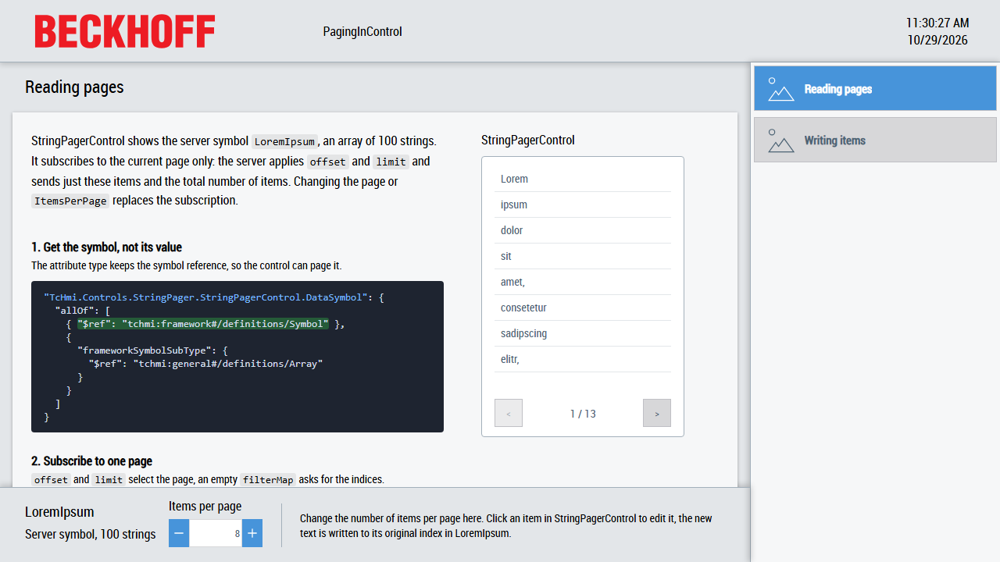

# PagingInControl

This sample shows how a control requests a server symbol which contains an array page by page instead of reading the whole array, and how it writes a changed item back to its original position in the array.



The solution contains two projects:

| Project                            | Content                                                                                                      |
| ---------------------------------- | ------------------------------------------------------------------------------------------------------------ |
| [StringPager](StringPager)         | A framework project with the control `StringPagerControl`, which shows and edits one page of a string array. |
| [PagingInControl](PagingInControl) | An HMI project which shows the server symbol `LoremIpsum` in `StringPagerControl`.                           |

[Desktop.view](PagingInControl/Desktop.view) uses the layout of the TwinCAT HMI BaseTemplate from the `Beckhoff.TwinCAT.HMI.BaseTemplate` package: a header at the top, a navigation on the right, a region for the pages in the center and a container at the bottom. The container sets the number of items per page through the internal symbol `ItemsPerPage` (default 8), which both pages bind to the attribute `ItemsPerPage` of `StringPagerControl`.

## Scenario

`LoremIpsum` is a server symbol with an array of 100 strings. To keep the sample lean it is an offline symbol: a server symbol without a mapping, defined in the `SYMBOLS` of [TcHmiSrv.Config.default.json](PagingInControl/Server/TcHmiSrv/TcHmiSrv.Config.default.json). The server keeps its value itself, so no PLC is needed. In a real project it is typically a mapped PLC array like `%s%PLC1.MAIN.aItems%/s%`. Paging works exactly the same for both kinds of server symbols.

Reading the whole array to show ten items wastes bandwidth and time, especially for large arrays. The server can filter, sort and page an array itself and only send the requested items. A control which wants to use this has to talk to the server directly instead of receiving the resolved value through a binding.

## Reading pages

The `Reading pages` page shows the same three steps as code excerpts. The complete code is in [StringPagerControl.ts](StringPager/StringPagerControl/StringPagerControl.ts).

### 1. Get the symbol, not its value

The attribute `DataSymbol` has the custom type `tchmi:framework#/definitions/TcHmi.Controls.StringPager.StringPagerControl.DataSymbol`, defined in [Types.Schema.json](StringPager/StringPagerControl/Schema/Types.Schema.json):

```json
"TcHmi.Controls.StringPager.StringPagerControl.DataSymbol": {
  "allOf": [
    {
      "$ref": "tchmi:framework#/definitions/Symbol"
    },
    {
      "frameworkSymbolSubType": {
        "$ref": "tchmi:general#/definitions/Array"
      }
    }
  ]
}
```

Values of this type are symbols which contain an array. Because the type is `Symbol`, the Framework passes the symbol itself to the setter `setDataSymbol` instead of resolving it. Without that the control would only receive the complete array.

### 2. Subscribe to one page

`__subscribeToDataSymbol` builds a server command for the current page and subscribes to it with `TcHmi.Server.subscribeEx`:

```ts
const command: Server.ICommand = {
    commandOptions: ['SendErrorMessage'],
    symbol: expressionName,
    offset: this.__currentPage * this.__innerItemsPerPage,
    limit: this.__innerItemsPerPage,
    filterMap: [],
};

this.__subscriptionId = TcHmi.Server.subscribeEx<string[]>([command], interval, null, this.__onDataSymbolPage);
```

`interval` is the interval of the symbol expression, for example `%s%LoremIpsum|Interval=1000%/s%`, or `websocketIntervalTime` from [tchmiconfig.json](PagingInControl/Properties/tchmiconfig.json) if it has none. The relevant properties of the command are:

- `offset`: the index of the first item which is sent to the client.
- `limit`: the maximum number of items which are sent to the client.
- `filterMap`: an empty array asks the server to fill in the original indices of the sent items. It is needed for writing.
- `orderBy`: sorts the items on the server before they are paged, for example `'{value} DESC'`. Not used in this sample.
- `filter`: filters the items before they are sorted and paged, for example `[{ comparator: 'contains', value: 'search string' }]`. Not used in this sample.

When the page or `ItemsPerPage` changes, the control removes the subscription with `TcHmi.Server.unsubscribeEx` and subscribes again with the new values. It also only subscribes while it is attached.

### 3. Show the page

`__onDataSymbolPage` receives the response of the subscription. `readValue` contains the items of the page, `maxEntries` the total number of items which match the filter and `filterMap` the original indices of the items. `__updateDisplay` shows the items, the page counter and enables the buttons.

## Writing items

The `Writing items` page shows these three steps as code excerpts.

### 1. Remember the original index

A page only contains some items of the array, possibly filtered and sorted by the server. To write an item back, the control needs its original index. Take an array `JumbledAlphabet` with the letters of the alphabet in random order, which is not part of this sample, and this command:

```ts
const command: Server.ICommand = {
    commandOptions: ['SendErrorMessage'],
    symbol: 'JumbledAlphabet',
    offset: 5,
    limit: 10,
    orderBy: '{value} ASC',
    filterMap: [],
};
```

the response contains:

```ts
{
    readValue: ['f', 'g', 'h', 'i', 'j', 'k', 'l', 'm', 'n', 'o'],
    filterMap: [19, 16, 22, 2, 8, 1, 23, 12, 7, 3],
    maxEntries: 26,
}
```

`'f'` is at index 19 of the array, `'g'` at index 16 and so on. `__updateDisplay` stores the index of each item in `data-index` of its element.

### 2. Finish the edit

Clicking an item replaces its text with a textbox, but only if the control is enabled and the user has the access right `operate` (`TcHmi.Access.checkAccess`). When the user finishes the input, `__onEditInteractionFinished` reads the stored index and passes it with the new text to `__writeToDataSymbol`.

### 3. Write to the original index

`__writeToDataSymbol` appends the index to the symbol name and writes only this item:

```ts
const symbol = expression.getName() + '[' + index + ']';

TcHmi.Server.writeSymbolEx(symbol, value, null, (data) => {
    this.__checkServerResult(data);
});
```

For `JumbledAlphabet` this writes to `JumbledAlphabet[19]`, the other items stay untouched. The subscription then delivers the changed page.

## Error handling

`__checkServerResult` checks the result of a server request step by step: the request itself, the response, the command and its read value. Errors are logged with `TcHmi.Log.Controls.error`, which adds the control, the attribute `DataSymbol` and its symbol expression to the message and checks the log level itself.

## Running the sample

1. Open [PagingInControl.sln](PagingInControl.sln) in Visual Studio or the TwinCAT XAE Shell with TwinCAT HMI Engineering installed.
2. Restore the NuGet packages, build the solution and start the Live-View of the `PagingInControl` project. No PLC is needed.
3. Use the buttons of `StringPagerControl` to switch between the pages and change `Items per page` at the bottom.
4. Select `Writing items` in the navigation and click an item to edit it. The new text is written to `LoremIpsum` and also shows up on the `Reading pages` page.

## Files

- [PagingInControl/Desktop.view](PagingInControl/Desktop.view): the BaseTemplate layout with the navigation, the region which hosts the pages and the input for the items per page.
- [PagingInControl/Pages/Reading.content](PagingInControl/Pages/Reading.content): `StringPagerControl` with the explanation of reading pages.
- [PagingInControl/Pages/Writing.content](PagingInControl/Pages/Writing.content): `StringPagerControl` with the explanation of writing items.
- [PagingInControl/Properties/tchmiconfig.json](PagingInControl/Properties/tchmiconfig.json): the internal symbol `ItemsPerPage`.
- [PagingInControl/Server/TcHmiSrv/TcHmiSrv.Config.default.json](PagingInControl/Server/TcHmiSrv/TcHmiSrv.Config.default.json): server configuration with the offline symbol `LoremIpsum`.
- [StringPager/StringPagerControl/StringPagerControl.ts](StringPager/StringPagerControl/StringPagerControl.ts): the control which subscribes to pages and writes items.
- [StringPager/StringPagerControl/Schema/Types.Schema.json](StringPager/StringPagerControl/Schema/Types.Schema.json): the type of the attribute `DataSymbol`.
- [StringPager/StringPagerControl/Template.html](StringPager/StringPagerControl/Template.html): the item list, the buttons and the page counter of the control. The theme dependent colors are in the `Themes` folder of the control.
