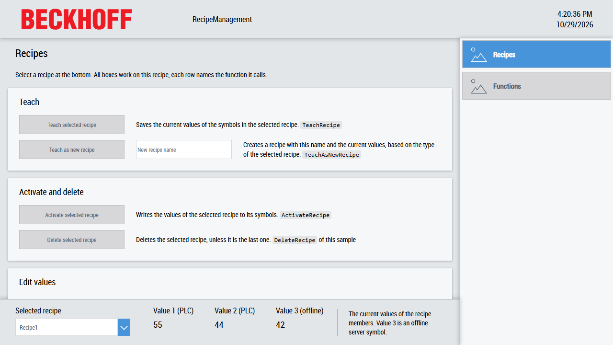

# RecipeManagement

This sample shows how to use the recipe management at runtime. It combines the recipe functions of the Actions and Conditions editor with own TypeScript functions which use the Framework API `Server.RecipeManagement`. The sample is a starting point for the recipe management and can be extended as needed. See also the chapter [Management in the engineering](https://infosys.beckhoff.com/content/1033/te2000_tc3_hmi_engineering/5737061387.html?id=14175300647116079) in Infosys.

## Running the sample

1. Open [TcHmiRecipeManagementSample.sln](TcHmiRecipeManagementSample.sln) in Visual Studio or the TwinCAT XAE Shell with TwinCAT HMI Engineering installed.
2. Activate the configuration of `TwinCAT Project1` and start the PLC.
3. Restore the NuGet packages, build the solution and start the Live-View of the `TcHmiRecipeManagementSample` project.
4. Select a recipe at the bottom and try the buttons on the pages.

## Overview

The solution contains two projects:

| Project                                                    | Content                                                                             |
| ---------------------------------------------------------- | ----------------------------------------------------------------------------------- |
| [TcHmiRecipeManagementSample](TcHmiRecipeManagementSample) | The HMI project with the recipe management server extension and the user interface. |
| [TwinCAT Project1](TwinCAT%20Project1)                     | A PLC with the variables `MAIN.Value1` and `MAIN.Value2`.                           |

[Desktop.view](TcHmiRecipeManagementSample/Desktop.view) uses the layout of the TwinCAT HMI BaseTemplate from the `Beckhoff.TwinCAT.HMI.BaseTemplate` package: a header at the top, a navigation on the right, a region for the pages in the center and a container at the bottom. The container holds the recipe selection, which all pages use, and the current values of the recipe members.

## Recipes and symbols

The recipe management server extension (`Beckhoff.TwinCAT.HMI.RecipeManagement`) contains two recipe types:

| Recipe type   | Members                                                                                     |
| ------------- | ------------------------------------------------------------------------------------------- |
| `RecipeType1` | `Value1` and `Value2`, mapped to the PLC symbols `PLC1.MAIN.Value1` and `PLC1.MAIN.Value2`. |
| `RecipeType2` | `Value3`, mapped to the offline server symbol `Value3`.                                     |

`Value3` shows that recipe members are not limited to PLC symbols: any server symbol works, for example symbols of OPC UA or of an own server extension. The recipes `Recipe1` to `Recipe4` are based on these types, `Recipe4` is in the folder `SubFolder1`. All of them are defined in [TcHmiRecipeManagement.Config.default.json](TcHmiRecipeManagementSample/Server/TcHmiRecipeManagement/TcHmiRecipeManagement.Config.default.json).

## User interface

### Recipe selection

The combobox `RecipeSelect` at the bottom shows all recipes. A recipe in a folder is shown with its path, for example `SubFolder1::Recipe4`. The buttons and the datagrid on the page Recipes use the selected recipe with `%ctrl%RecipeSelect::SelectedValue%/ctrl%`. Next to it the current values of `Value1`, `Value2` and `Value3` are shown.

### Recipes

The page groups the controls in four boxes. All of them work on the recipe which is selected at the bottom.

**Teach**

- **Teach selected recipe**: reads the current values of the symbols and saves them in the selected recipe.
- **Teach as new recipe**: creates a new recipe with the current values of the symbols, based on the recipe type of the selected recipe. Enter the name of the new recipe in the text box next to the button.

**Activate and delete**

- **Activate selected recipe**: writes the values of the selected recipe to its symbols.
- **Delete selected recipe**: deletes the selected recipe. A condition prevents deleting the last recipe, because then no new recipe could be taught in the client anymore.

**Edit values**

The datagrid `RecipeDatagrid` shows the members of the selected recipe with their saved values. The column "New value" has two uses:

- Enter new values and save them in the recipe with **Update selected recipe**.
- **Read values from target** fills the column with the current values of the symbols, to compare them with the saved values.

**Recipe files**

- **Download selected recipe**: saves the selected recipe as a file in the browser.
- **Upload recipe files**: opens the file selection of the browser and adds the recipes of the selected files.

*Note*: Download and upload are not available in the Live-View of Visual Studio.

Teach, teach as new, activate, download and upload use the functions `TeachRecipe`, `TeachAsNewRecipe`, `ActivateRecipe`, `DownloadRecipes` and `UploadRecipeFiles` of the `Beckhoff.TwinCAT.HMI.Functions` package. Delete, update and read from target use the functions `DeleteRecipe`, `ConvertDatagridToRecipe` and `UpdateDatagridFromTarget` of this sample.

### Functions

One box per function of this sample: where it is used, which API it calls and an excerpt of its implementation, with the calls of `Server.RecipeManagement` highlighted.

## Functions of this sample

The folder [RecipeFunctions](TcHmiRecipeManagementSample/RecipeFunctions) contains five TypeScript functions. Each consists of a `.ts` file and a `.function.json` file with the description for the Actions and Conditions editor. The functions are ES modules: they import the Framework API from `Beckhoff.TwinCAT.HMI.Framework/index.esm.js` and are listed with the type `EsModule` in the `dependencyFiles` of [tchmiconfig.json](TcHmiRecipeManagementSample/Properties/tchmiconfig.json). Each file registers its function with `Functions.registerFunctionEx` in the namespace `TcHmi.Functions.RecipeManagementSample`, so triggers and bindings call them for example as `TcHmi.Functions.RecipeManagementSample.DeleteRecipe`.

| Function                      | Used by                       | API                                                                                      |
| ----------------------------- | ----------------------------- | ---------------------------------------------------------------------------------------- |
| `ListRecipesAsReferenceArray` | `SrcData` of `RecipeSelect`   | None. Converts `TcHmiRecipeManagement.Config::recipeList` to a flat array of references. |
| `ConvertRecipeToDatagrid`     | `SrcData` of `RecipeDatagrid` | `getRecipe`                                                                              |
| `ConvertDatagridToRecipe`     | Update selected recipe        | `updateRecipe`                                                                           |
| `UpdateDatagridFromTarget`    | Read values from target       | `readFromTarget`                                                                         |
| `DeleteRecipe`                | Delete selected recipe        | `deleteRecipe`                                                                           |

The asynchronous functions get a context object `ctx` and call `ctx.success` or `ctx.error` when the server answered. `ListRecipesAsReferenceArray` is synchronous and returns its result.

`RecipeDatagrid` binds `SrcData` again with the function `CreateBinding` whenever `TcHmiRecipeManagement.Config::recipeList` changes, so the datagrid also shows the values after a teach or an update.

## Further information

- [Logic in the background](https://infosys.beckhoff.com/content/1033/te2000_tc3_hmi_engineering/5872675083.html?id=1883451105835014634) (documentation in Infosys)
- [Extension with filter function](../RecipeManagementFilter/README.md)
