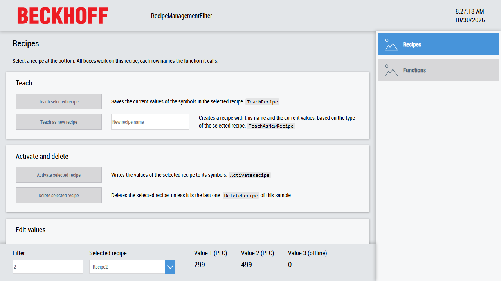

# RecipeManagementFilter

This sample is the [RecipeManagement](../RecipeManagement/README.md) sample, extended by a filter: a text box limits the recipe selection to the recipes whose name or folder contains the entered text.



The solution contains two projects:

| Project                                                                | Content                                                                             |
| ---------------------------------------------------------------------- | ----------------------------------------------------------------------------------- |
| [TcHmiRecipeManagementFilterSample](TcHmiRecipeManagementFilterSample) | The HMI project with the recipe management server extension and the user interface. |
| [TwinCAT Project1](TwinCAT%20Project1)                                 | A PLC with the variables `MAIN.Value1` and `MAIN.Value2`.                           |

The user interface, the recipes and the functions are the same as in [RecipeManagement](../RecipeManagement/README.md), which describes them in detail. This README only describes the filter. On the page Functions, the box of `ListRecipesAsReferenceArray` highlights the filter.

## The filter

The container at the bottom of [Desktop.view](TcHmiRecipeManagementFilterSample/Desktop.view) contains the text box `RecipeFilter` in front of the recipe selection `RecipeSelect`. The combobox gets its recipes from the function `ListRecipesAsReferenceArray`, which has a second parameter for the filter text:

```
%f%TcHmi.Functions.RecipeManagementFilterSample.ListRecipesAsReferenceArray(
    %s%TcHmiRecipeManagement.Config::recipeList%/s%, %ctrl%RecipeFilter::Text%/ctrl%)%/f%
```

The binding calls the function again whenever the recipe list or the text of the filter changes. The function only returns the recipe references which contain the filter text, regardless of upper and lower case. An empty filter returns all recipes. The reference includes the folder, so `sub` finds `SubFolder1::Recipe4`.

```ts
export function ListRecipesAsReferenceArray(
    recipeList: Server.RecipeManagement.FolderRecipe | null,
    filterText: string | null
): string[] {
    // ...
    const filter = (filterText ?? '').toLowerCase();
    // ...
    if (reference.toLowerCase().includes(filter)) {
        result.push(reference);
    }
    // ...
}
```

See [ListRecipesAsReferenceArray.ts](TcHmiRecipeManagementFilterSample/RecipeFunctions/ListRecipesAsReferenceArray.ts) and its description [ListRecipesAsReferenceArray.function.json](TcHmiRecipeManagementFilterSample/RecipeFunctions/ListRecipesAsReferenceArray.function.json) with the parameter `filterText`.

The functions of this sample are registered in the namespace `TcHmi.Functions.RecipeManagementFilterSample`, so they do not collide with the functions of RecipeManagement when both are used in one project.

*Note*: The button Delete selected recipe only deletes a recipe if the combobox lists more than one recipe. With an active filter this counts the listed recipes, not all recipes: if the filter leaves only one recipe, clear the filter to delete it.

## Running the sample

1. Open [TcHmiRecipeManagementFilterSample.sln](TcHmiRecipeManagementFilterSample.sln) in Visual Studio or the TwinCAT XAE Shell with TwinCAT HMI Engineering installed.
2. Activate the configuration of `TwinCAT Project1` and start the PLC.
3. Restore the NuGet packages, build the solution and start the Live-View of the `TcHmiRecipeManagementFilterSample` project.
4. Enter a part of a recipe name in the filter at the bottom, for example `2`, and open the recipe selection.

## Further information

- [RecipeManagement](../RecipeManagement/README.md): the sample without filter, with the description of the user interface and the functions
- [Logic in the background](https://infosys.beckhoff.com/content/1033/te2000_tc3_hmi_engineering/5872675083.html?id=1883451105835014634) (documentation in Infosys)
