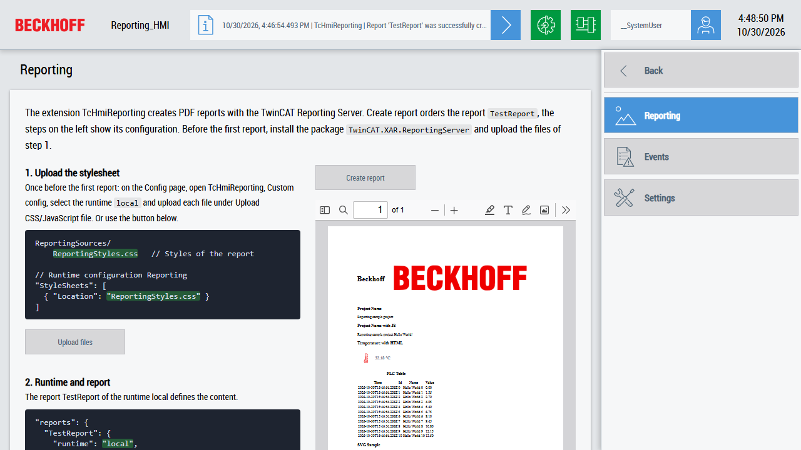
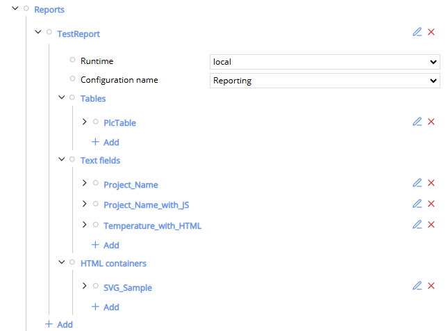
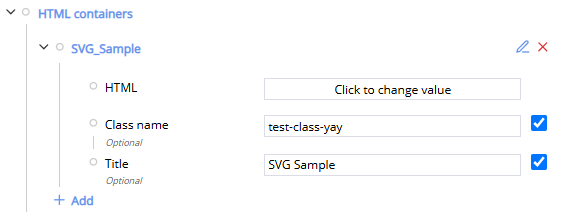
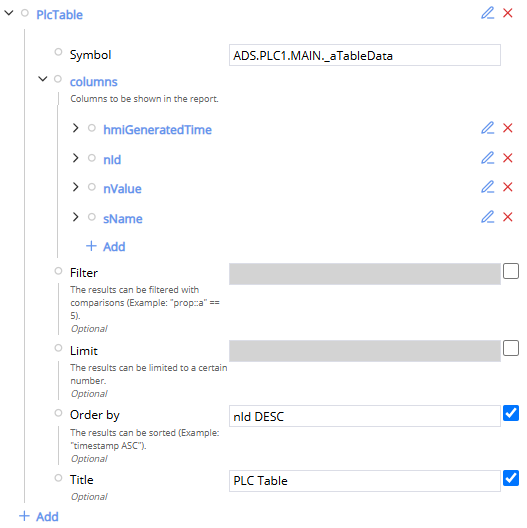
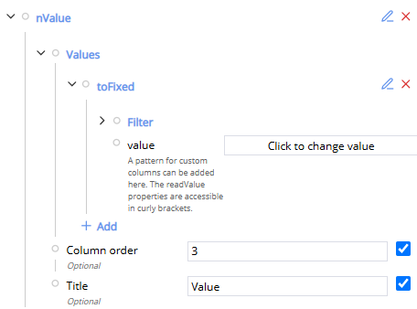
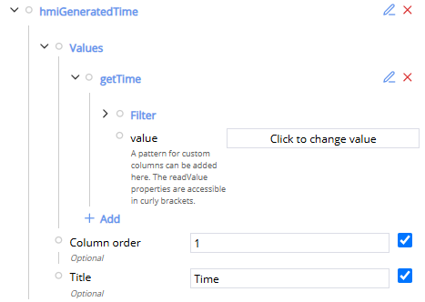

# Reporting

This sample shows how to configure the TcHmiReporting extension and the content elements of a report: HTML containers, text fields and tables. The page `Reporting` explains the configuration and creates the report.



## Running the sample

To run the sample you need:

- The PLC of `Reporting_XAE`, activated and running. It uses the libraries `Tc2_ControllerToolbox`, `Tc2_Standard`, `Tc2_System` and `Tc3_Module`.
- The TwinCAT Reporting Server for the reports, see [Set up the reporting server](#set-up-the-reporting-server).

Then run the sample:

1. Open [Reporting.sln](Reporting.sln) in Visual Studio or the TwinCAT XAE Shell with TwinCAT HMI Engineering installed.
2. Activate the configuration of `Reporting_XAE` and start the PLC.
3. Restore the NuGet packages, build the solution and start the Live-View of `Reporting_HMI`.
4. Upload the stylesheet once with `Upload files` on the page `Reporting`. Then click `Create report`.

### Set up the reporting server

Do these steps once before the first report:

1. Install the TwinCAT Reporting Server, the package `TwinCAT.XAR.ReportingServer`, with the TwinCAT Package Manager or on the command line:

   ```cmd
   tcpkg install TwinCAT.XAR.ReportingServer
   ```

   Without it, creating a report fails with `Target port could not be found. (AdsErrorCode: 6, 0x6)`.
2. Upload the stylesheet [ReportingStyles.css](Reporting_HMI/ReportingSources/ReportingStyles.css) to the runtime `local`. Without it, the temperature in the report has no layout. There are two ways:
   - Start the Live-View of `Reporting_HMI` and click `Upload files` on the page `Reporting`, below step 1.
   - Or open the Config page of the server, go to TcHmiReporting, Custom config, select the runtime `local`, then select the file under `Upload CSS/JavaScript file` and upload it.

## Overview

The solution contains two projects:

| Project                        | Content                                                                                          |
| ------------------------------ | ------------------------------------------------------------------------------------------------ |
| [Reporting_HMI](Reporting_HMI) | The HMI project with the reporting server extension and the page `Reporting`.                   |
| [Reporting_XAE](Reporting_XAE) | A PLC with the project name `MAIN._sProjectName`, the table data `MAIN._aTableData` and the temperature `MAIN._temperature`. |

[Desktop.view](Reporting_HMI/Desktop.view) uses the layout of the TwinCAT HMI BaseTemplate from the `Beckhoff.TwinCAT.HMI.BaseTemplate` package: a header at the top, a navigation on the right and a region for the pages in the center. The navigation contains these pages:

| Page                                                 | Content                                                                                            |
| ---------------------------------------------------- | -------------------------------------------------------------------------------------------------- |
| [Reporting](Reporting_HMI/Pages/Reporting.content)   | The configuration of the report with code excerpts on the left, the report on the right.         |
| [Events](Reporting_HMI/Pages/Events.content)         | `TcHmiEventGrid` with the messages, for example of the extension TcHmiReporting.                   |
| [Settings](Reporting_HMI/Pages/Settings.content)     | The language and the theme of the HMI.                                                             |

## How it works

The configuration of the extension is in [TcHmiReporting.Config.default.json](Reporting_HMI/Server/TcHmiReporting/TcHmiReporting.Config.default.json). On the Config page of the server it is under TcHmiReporting.

### Runtime and report

The runtime `local` connects to the reporting server on this computer (`127.0.0.1.1.1`). Its configuration `Reporting` defines the general appearance of the report pages: header, footer, logo and the uploaded stylesheets and scripts.

The report `TestReport` under `Reports` refers to the runtime and its configuration and defines the content: `HTML containers`, `Text fields` and `Tables`.



### HTML containers

The HTML container is the simplest way to show content in the report. It contains custom HTML, a title and optional CSS classes. `SVG_Sample` shows an SVG image.



### Text fields

A text field shows the value of one symbol. Its `value` is HTML, in which `{value}` is replaced by the value of the symbol. A `<script>` in `value` can change the output. `Project_Name_with_JS` adds a text to the project name:

```html
<script>
    var scriptTag = document.getElementsByTagName('script');
    var parent = scriptTag[scriptTag.length - 1].parentNode;

    var valueFull = "{value}";
    parent.innerHTML = valueFull + " Hello World!";
</script>
```

`Temperature_with_HTML` shows the temperature with an icon whose color depends on the value. Its classes are defined in the uploaded stylesheet [ReportingStyles.css](Reporting_HMI/ReportingSources/ReportingStyles.css), which the runtime configuration `Reporting` lists under `StyleSheets`.

### Tables

A table shows a symbol with an array, one row per element. `PlcTable` reads `ADS.PLC1.MAIN._aTableData`, whose elements have the properties `nId`, `sName` and `nValue`, and sorts the rows with `orderBy` `nId DESC`.



A column shows the property with the same name as the column. The `value` of an entry in `values` of the column can change the cell with a script, `{value}` is the element of the row:



```html
<script>
    var scriptTag = document.getElementsByTagName('script');
    var parent = scriptTag[scriptTag.length - 1].parentNode;

    var valueFull = {value};
    parent.innerHTML = valueFull.nValue.toFixed(2);
</script>
```

A column which is not based on a property needs such a value, otherwise its cells stay empty. The column `hmiGeneratedTime` writes the time of the report:



```html
<script>
    var scriptTag = document.getElementsByTagName('script');
    var parent = scriptTag[scriptTag.length - 1].parentNode;

    var date = new Date();
    parent.innerHTML = date.toISOString();
</script>
```

### Upload the stylesheet

The button `Upload files` calls the function [UploadReportingSources](Reporting_HMI/ReportingFunctions/UploadReportingSources.ts). It loads `ReportingStyles.css` from the HMI server and writes it to the function symbol `TcHmiReporting.AddResource`, like the upload on the Config page:

```ts
{ name: 'ReportingStyles', data: '<content of ReportingStyles.css>', type: 0, runtime: 'local' }
```

`name` is the file name without extension, `type` is `0` for CSS and `1` for JavaScript. The function returns a short text, which the button writes to the text next to it.

### Create a report

The button `Create report` first clears the PDF viewer and then writes the name of the report to the function symbol `TcHmiReporting.OrderReport`:

```json
{
  "objectType": "WriteToSymbol",
  "symbolExpression": "%s%TcHmiReporting.OrderReport%/s%",
  "value": { "objectType": "StaticValue", "valueType": "tchmi:general#/definitions/String", "value": "TestReport" }
}
```

The extension stores the PDF in the folder `reports` of its extension directory. The virtual directory `/TcHmiReporting` in the configuration of the server (TcHmiSrv, Virtual directories) maps this folder to the URL `/TcHmiReporting/reports/TestReport.pdf`. `overwriteReports` is set in the configuration of TcHmiReporting, so there is only one file per report, which a new report overwrites.

The `TcHmiPdfViewer` of the `Beckhoff.TwinCAT.HMI.PDFViewer` package shows the report. Its trigger reads `TcHmiReporting.Diagnostics::reportsInProgress`: when the button set the internal symbol `ReportOrdered` and no report is in progress anymore, it loads the PDF again. A timestamp in the URL prevents that the browser shows the old report from its cache.

The Config page can create reports as well: under TcHmiReporting, Custom config, select the runtime `local` and the report `TestReport` and click `Create`.
