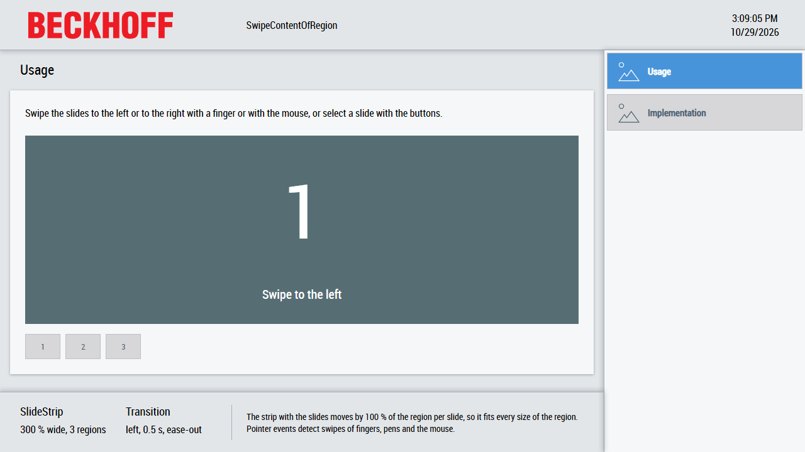

# SwipeContentOfRegion

This sample shows how a region switches between several contents with an animation when the user swipes with a finger, a pen or the mouse.



## Running the sample

1. Open [SwipeContentOfRegion.sln](SwipeContentOfRegion.sln) in Visual Studio or the TwinCAT XAE Shell with TwinCAT HMI Engineering installed.
2. Restore the NuGet packages, build the solution and start the Live-View of the `SwipeContentOfRegion` project.
3. Swipe the slides with the mouse or, on a touch screen, with a finger, or press the buttons below the region.

## Overview

[Desktop.view](SwipeContentOfRegion/Desktop.view) uses the layout of the TwinCAT HMI BaseTemplate from the `Beckhoff.TwinCAT.HMI.BaseTemplate` package: a header at the top, a navigation on the right, a region for the pages in the center and a container at the bottom with a short summary. The `Usage` page contains the swipeable region, the `Implementation` page explains the building blocks with code excerpts.

## How it works

The region `SlideRegion` on the `Usage` page does not load the slides directly. It loads the content `SlideStrip`, which is three times as wide as the region and contains one region per slide side by side. The region only shows the part of the strip which lies within its bounds. To switch a slide, the code moves the strip to the left or to the right, and a CSS transition animates the move.

### 1. A strip with three slides

[Slides/SlideStrip.content](SwipeContentOfRegion/Slides/SlideStrip.content) has a width of 300 % of the region. It contains the regions `SlideRegion1` to `SlideRegion3`, each with a width of 33.3334 % of the strip and the left positions 0 %, 33.3333 % and 66.6667 %. They load [Slide1.content](SwipeContentOfRegion/Slides/Slide1.content) to [Slide3.content](SwipeContentOfRegion/Slides/Slide3.content).

All sizes and positions use the unit %, so the slides always fill the region, whatever size it has. `SlideRegion` stretches with the page.

### 2. Animate the move

[Swipe.css](SwipeContentOfRegion/Swipe.css) is a stylesheet in the `dependencyFiles` of [tchmiconfig.json](SwipeContentOfRegion/Properties/tchmiconfig.json):

```css
#SlideStrip {
    transition-property: left;
    transition-duration: 0.5s;
    transition-timing-function: ease-out;
    user-select: none;
}

#SlideStrip,
#SlideStrip * {
    touch-action: pan-y;
}
```

The transition animates every change of the left position of `SlideStrip`. `user-select: none` prevents text selection while swiping with the mouse.

`touch-action: pan-y` lets the browser only scroll vertically, so horizontal finger movements reach the code as pointer events. Without it the browser takes over a horizontal finger movement and cancels the pointer events, which is why swiping with the mouse works anyway. The rule applies to all elements on the strip as well: the slide regions are scroll containers, and the browser only combines the `touch-action` of an element with its ancestors up to the next scroll container.

### 3. Show a slide

`showSlide` in [CodeBehindSwipe.ts](SwipeContentOfRegion/CodeBehindSwipe.ts) sets the left position of the strip. Its unit is %, so `-100` moves the strip by exactly one slide:

```ts
function showSlide(index: number) {
    const strip = Controls.get<TcHmiContent.Control>('SlideStrip');
    if (!strip) {
        return;
    }
    slideIndex = Math.min(Math.max(index, 0), SLIDE_COUNT - 1);
    strip.setLeft(-slideIndex * 100);
}
```

The buttons `SlideButton1` to `SlideButton3` below the region call `showSlide` in their `onPressed` events.

### 4. Detect a swipe

Pointer events cover fingers, pens and the mouse with one code path. The code-behind adds the listeners to the element of `SlideStrip` in `SlideStrip.onAttached` and removes them in `SlideStrip.onDetached`, so they only exist while the strip is shown:

- `pointerdown` stores the horizontal start position.
- `pointermove` calculates the distance to the start position. Once the pointer moved 40 px (`SWIPE_DISTANCE`) to the left, the next slide is shown, 40 px to the right shows the previous slide. Then the swipe ends, so one swipe switches only one slide.
- `pointerup`, `pointercancel` and `pointerleave` end the swipe.

## Files

- [SwipeContentOfRegion/Desktop.view](SwipeContentOfRegion/Desktop.view): the BaseTemplate layout with the navigation, the region which hosts the pages and the summary at the bottom.
- [SwipeContentOfRegion/Pages/Usage.content](SwipeContentOfRegion/Pages/Usage.content): the region `SlideRegion` with the strip and the buttons.
- [SwipeContentOfRegion/Pages/Implementation.content](SwipeContentOfRegion/Pages/Implementation.content): the building blocks as code excerpts.
- [SwipeContentOfRegion/Slides](SwipeContentOfRegion/Slides): the strip and the three slides.
- [SwipeContentOfRegion/CodeBehindSwipe.ts](SwipeContentOfRegion/CodeBehindSwipe.ts): switches the slides. It is loaded as an ES module (`dependencyFiles` in tchmiconfig.json).
- [SwipeContentOfRegion/Swipe.css](SwipeContentOfRegion/Swipe.css): the transition of the strip.
