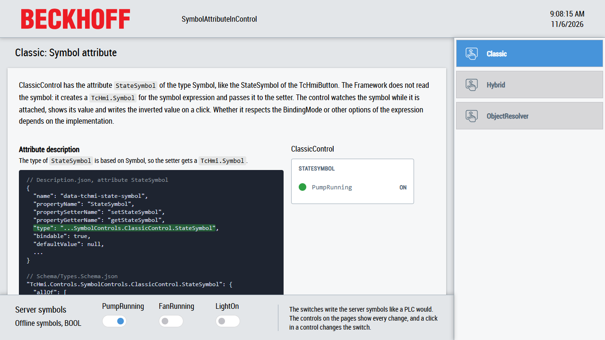

# SymbolAttributeInControl

This sample shows three ways a control can read and write a symbol through one of its attributes: a symbol attribute like the `StateSymbol` of the button, a hybrid value attribute which takes full control over the symbol of a binding, and a symbol inside an object which the control resolves with the `TcHmi.ObjectResolver`.



## Running the sample

1. Open [SymbolAttributeInControl.sln](SymbolAttributeInControl.sln) in Visual Studio or the TwinCAT XAE Shell with TwinCAT HMI Engineering installed.
2. Restore the NuGet packages, build the solution and start the Live-View of the `HMI` project. No PLC is needed.
3. Select `Classic`, `Hybrid` or `ObjectResolver` in the navigation.
4. Click a row in a control or switch a server symbol at the bottom. Both show the new state.

## Overview

The solution contains two projects:

| Project                          | Content                                                                                                |
| -------------------------------- | ------------------------------------------------------------------------------------------------------ |
| [SymbolControls](SymbolControls) | A framework project with the controls `ClassicControl`, `HybridControl` and `ObjectResolverControl`.   |
| [HMI](HMI)                       | An HMI project with one page per control. The controls use the server symbols of the bottom container. |

The controls are ES modules: they import the Framework API from `Beckhoff.TwinCAT.HMI.Framework/index.esm.js`, like the control `ColorChange` in the [ExampleControls](../ExampleControls) sample. All three controls show a boolean state with a lamp and toggle it on a click. They only differ in how their attribute gets to the symbol:

| Control                 | Attribute     | Attribute type                | The control receives                                  | Writes in this sample     |
| ----------------------- | ------------- | ----------------------------- | ----------------------------------------------------- | ------------------------- |
| `ClassicControl`        | `StateSymbol` | Symbol                        | A `TcHmi.Symbol` in the setter                        | Always, like the button   |
| `HybridControl`         | `State`       | Boolean with `bindableAsRef`  | A value in the setter or a `TcHmi.Symbol` on an event | With `BindingMode=TwoWay` |
| `ObjectResolverControl` | `Entries`     | List of objects with a Symbol | A `TcHmi.Symbol` in each resolved entry               | Always, like the button   |

[Desktop.view](HMI/Desktop.view) uses the layout of the TwinCAT HMI BaseTemplate from the `Beckhoff.TwinCAT.HMI.BaseTemplate` package: a header at the top, a navigation on the right, a region for the pages in the center and a container with the server symbols at the bottom. Each page has the same structure as the sections below: a short explanation, the attribute description from `Description.json` and `Types.Schema.json`, the implementation in the control and the usage in the HMI. The parts which matter for the variant are highlighted.

`PumpRunning`, `FanRunning` and `LightOn` are BOOL symbols. To keep the sample lean they are offline symbols: server symbols without a mapping, defined in the `SYMBOLS` of [TcHmiSrv.Config.default.json](HMI/Server/TcHmiSrv/TcHmiSrv.Config.default.json). The server keeps their values itself, so no PLC is needed. In a real project they are typically mapped PLC variables like `%s%PLC1.MAIN.bPumpRunning%/s%`. The toggle switches in the bottom container write the symbols through their `StateSymbol` attribute, like a PLC would change its variables.

## How it works

### Classic: a symbol attribute

`ClassicControl` has the attribute `StateSymbol`, like the `StateSymbol` of the TcHmiButton. The Framework does not read the symbol: it creates a `TcHmi.Symbol` for the symbol expression and passes it to the setter.

#### Attribute description

The important part is the type of the attribute: it is based on `tchmi:framework#/definitions/Symbol`. [Description.json](SymbolControls/ClassicControl/Description.json) refers to a type in [Types.Schema.json](SymbolControls/ClassicControl/Schema/Types.Schema.json), which adds the type of the value with `frameworkSymbolSubType`:

```json
"name": "data-tchmi-state-symbol",
"propertyName": "StateSymbol",
"type": "tchmi:framework#/definitions/TcHmi.Controls.SymbolControls.ClassicControl.StateSymbol",
```

```json
"TcHmi.Controls.SymbolControls.ClassicControl.StateSymbol": {
  "allOf": [
    { "$ref": "tchmi:framework#/definitions/Symbol" },
    { "frameworkSymbolSubType": { "$ref": "tchmi:general#/definitions/Boolean" } }
  ]
}
```

#### Implementation

The control owns the symbol it receives: it watches it while it is attached, writes it and destroys it when the attribute changes or the control is destroyed. The code is in [ClassicControl.ts](SymbolControls/ClassicControl/ClassicControl.ts):

- `setStateSymbol` destroys the watch and then the previous symbol, stores the new one and watches it if the control is attached. The order matters: destroying a symbol does not end its watches, only the destroy function of a watch does. `destroy` also ends the watch before it destroys the symbol, because `super.destroy()` ends it with `__detach()` only afterwards.
- `__attach` watches the symbol, `__detach` stops the watch. The symbol is kept for the next attach.
- The watch callback stores the value and shows it. The control only writes after a first value, so it never overwrites the symbol with a value it did not read.
- A click writes the inverted value. The display changes when the watch reports the new value.

Whether a symbol attribute respects the `BindingMode` or other options of the symbol expression depends on the implementation. The control can read them with `getExpression().getOptions()` of the symbol and, for example, only write with `BindingMode=TwoWay` if that is useful for the control. For a state like the `StateSymbol` of the button it is not, so `ClassicControl` always writes.

#### Usage

The attribute contains the symbol expression:

```html
<div id="ClassicPump" data-tchmi-type="TcHmi.Controls.SymbolControls.ClassicControl" data-tchmi-state-symbol="%s%PumpRunning%/s%"></div>
```

### Hybrid: a value or a binding

`HybridControl` has the attribute `State` of the type `tchmi:general#/definitions/Boolean`. This is the main goal of a hybrid attribute: an existing value attribute gets full control over the symbol of a binding, like `StateSymbol` in the classic implementation, but without an additional attribute which only accepts symbol references. The attribute still accepts everything a value attribute accepts: a static value, a value from an action or from code, or a binding. Only when it is bound to a symbol, the control handles the symbol itself. Static values and bindings are configured as usual, so existing configurations keep working.

#### Attribute description

The important part is `bindableAsRef` in [Description.json](SymbolControls/HybridControl/Description.json):

```json
"name": "data-tchmi-state",
"propertyName": "State",
"type": "tchmi:general#/definitions/Boolean",
"bindable": true,
"bindableAsRef": true,
"allowEarlySymbolReferenceInjection": true,
```

- `bindableAsRef` makes the binding hand over its `TcHmi.Symbol` instead of writing the value of the symbol to the setter. The binding raises the event `<controlId>.onAttributeSymbolReferenceChanged` with the property name and the symbol, and with a `null` symbol when the binding is removed. The setter only ever receives values. The flag is required: without it the binding writes the value of the symbol to the setter like for any attribute, and the event is never raised for the attribute.
- `allowEarlySymbolReferenceInjection` lets the binding hand over the symbol before the control is initialized. The control only watches the symbol once it is attached.

#### Implementation

The code is in [HybridControl.ts](SymbolControls/HybridControl/HybridControl.ts):

- `__previnit` registers the event `onAttributeSymbolReferenceChanged`, not `__init`: the bindings are created between `__previnit` and `__init`, so a later registration would miss the symbol.
- `__onAttributeSymbolReferenceChanged` releases the previous symbol, first its watch, and takes over the new one. Like `ClassicControl` it owns the symbol and destroys it. Without a symbol it sets `State` back to its default.
- The watch callback passes the value of the symbol to `setState` and marks it, so the setter does not write it back.
- `setState` writes every other change to the symbol, like a TwoWay binding writes every change of its attribute. It only writes after the attribute phase, after a first value of the symbol and only if the binding uses `BindingMode=TwoWay`, which `Binding.resolveEx('State', this)` tells. With a OneWay binding a click only changes the control until the symbol changes the next time.
- When writing fails, the control shows the value of the symbol again, like `symbolWriteError: ReadBack` in [tchmiconfig.json](HMI/Properties/tchmiconfig.json) does for a binding.

#### Usage

The page uses the control with a static value, a OneWay binding and a TwoWay binding:

```html
<div id="HybridStatic" data-tchmi-type="TcHmi.Controls.SymbolControls.HybridControl" data-tchmi-state="true"></div>
<div id="HybridOneWay" data-tchmi-type="TcHmi.Controls.SymbolControls.HybridControl" data-tchmi-state="%s%PumpRunning%/s%"></div>
<div id="HybridTwoWay" data-tchmi-type="TcHmi.Controls.SymbolControls.HybridControl" data-tchmi-state="%s%PumpRunning|BindingMode=TwoWay%/s%"></div>
```

Click the OneWay and the TwoWay control and watch the `PumpRunning` switch at the bottom: only the TwoWay control changes the symbol.

### ObjectResolver: a symbol inside an object

`ObjectResolverControl` has the attribute `Entries`, a list of objects with a `label` and a `stateSymbol`. The Framework does not resolve symbol expressions inside an object: the control resolves the value with a `TcHmi.ObjectResolver`, see the [ObjectResolver](../ObjectResolver) sample for the details.

#### Attribute description

Two parts are important. `allowSymbolExpressionsInObject` in [Description.json](SymbolControls/ObjectResolverControl/Description.json) allows symbol expressions inside the objects:

```json
"name": "data-tchmi-entries",
"propertyName": "Entries",
"type": "tchmi:framework#/definitions/TcHmi.Controls.SymbolControls.ObjectResolverControl.EntryList",
"allowSymbolExpressionsInObject": true,
```

In [Types.Schema.json](SymbolControls/ObjectResolverControl/Schema/Types.Schema.json) `stateSymbol` has a type based on `tchmi:framework#/definitions/Symbol`:

```json
"TcHmi.Controls.SymbolControls.ObjectResolverControl.EntryList": {
  "type": "array",
  "items": { "$ref": "tchmi:framework#/definitions/TcHmi.Controls.SymbolControls.ObjectResolverControl.Entry" }
},
"TcHmi.Controls.SymbolControls.ObjectResolverControl.Entry": {
  "type": "object",
  "properties": {
    "label": { "type": "string" },
    "stateSymbol": { "$ref": "tchmi:framework#/definitions/TcHmi.Controls.SymbolControls.ObjectResolverControl.StateSymbol" }
  }
},
"TcHmi.Controls.SymbolControls.ObjectResolverControl.StateSymbol": {
  "allOf": [
    { "$ref": "tchmi:framework#/definitions/Symbol" },
    { "frameworkSymbolSubType": { "$ref": "tchmi:general#/definitions/Boolean" } }
  ]
}
```

The control passes the type of the attribute to the resolver. Because of the type of `stateSymbol` the resolver does not read the symbol but puts a `TcHmi.Symbol` into the resolved entry. A property of another type, for example a number, gets the value of its symbol instead.

#### Implementation

The code is in [ObjectResolverControl.ts](SymbolControls/ObjectResolverControl/ObjectResolverControl.ts):

- `setEntries` creates the resolver with the type of the attribute and registers it in `__objectResolvers`, so the base class watches it while the control is attached and destroys it with the control.
- The watch callback creates one row per entry and watches the `stateSymbol` of each entry.
- A click on a row writes the inverted value to the symbol of the entry.
- The symbols belong to the resolver, not to the control. The control only watches and writes them and never destroys them. The resolver destroys the symbols when the base class stops its watch in `__detach` and when `setEntries` replaces it. The control ends the watches of the rows before, because destroying a symbol does not end its watches. The next watch callback after the attach delivers new symbols.

#### Usage

Each entry contains the symbol expression of its state:

```html
<div id="ObjectResolverEntries" data-tchmi-type="TcHmi.Controls.SymbolControls.ObjectResolverControl">
<script data-tchmi-target-attribute="data-tchmi-entries" type="application/json">
[
  { "label": "Pump", "stateSymbol": "%s%PumpRunning%/s%" },
  { "label": "Fan", "stateSymbol": "%s%FanRunning%/s%" },
  { "label": "Light", "stateSymbol": "%s%LightOn%/s%" }
]
</script>
</div>
```

## Further information

- [Controls](https://infosys.beckhoff.com/content/1033/te2000_tc3_hmi_engineering/8971583499.html?id=6326028457938979673) (documentation in Infosys)
- [ObjectResolver](https://infosys.beckhoff.com/content/1033/te2000_tc3_hmi_engineering/8973393163.html) (documentation in Infosys)
- [ObjectResolver](../ObjectResolver) sample: writes the values of symbol expressions inside an object
- [SymbolChangeTrigger](../SymbolChangeTrigger) sample: reacts to the change of a symbol without a control
