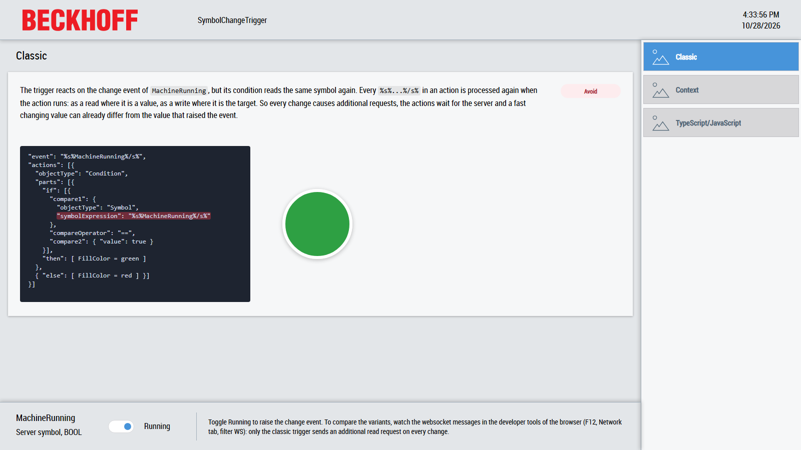

# SymbolChangeTrigger

This sample shows how an HMI should react on the change of a server symbol, for example a mapped PLC variable, without sending additional requests to the TwinCAT HMI Server.



The sample contains three variants of the same logic. Each variant is a content page with a circle which is green while the server symbol `MachineRunning` is `true` and red while it is `false`:

| Variant               | Page                                                                 | Implementation                                                                  | Recommendation                     |
| --------------------- | -------------------------------------------------------------------- | ------------------------------------------------------------------------------- | ---------------------------------- |
| Classic               | [Classic.content](SymbolChangeTrigger/Pages/Classic.content)         | A trigger on the symbol which reads the same symbol again in its condition.     | Avoid                              |
| Context               | [Context.content](SymbolChangeTrigger/Pages/Context.content)         | A trigger on the symbol which uses the value of the event `%ctx%args[0]%/ctx%`. | Recommended for triggers           |
| TypeScript/JavaScript | [TypeScript.content](SymbolChangeTrigger/Pages/TypeScript.content)   | A code-behind file which watches the symbol.                                    | Recommended for more complex logic |

All three circles behave identically. They only differ in how they get the value of the symbol. Each page also shows a short explanation and the relevant excerpt of its trigger or code.

[Desktop.view](SymbolChangeTrigger/Desktop.view) uses the layout of the TwinCAT HMI BaseTemplate from the `Beckhoff.TwinCAT.HMI.BaseTemplate` package: a header at the top, a navigation on the right, a region for the pages in the center and a container with the server symbol at the bottom. The region only loads the page which is selected in the navigation, and a trigger or code-behind only subscribes to the symbol while its page is loaded, so only one variant is active at a time. This keeps the requests of the variants apart when you watch the communication with the server.

## Scenario

`MachineRunning` is a BOOL symbol. To keep the sample lean it is an offline symbol: a server symbol without a mapping, defined in the `SYMBOLS` of [TcHmiSrv.Config.default.json](SymbolChangeTrigger/Server/TcHmiSrv/TcHmiSrv.Config.default.json). The server keeps its value itself, so no PLC is needed. In a real project it is typically a mapped PLC variable like `%s%PLC1.MAIN.bMachineRunning%/s%`. The logic is exactly the same for both kinds of server symbols.

The `Running` toggle switch in the bottom container writes the symbol through its `StateSymbol` attribute, like a PLC would change its variable.

## How a trigger reacts on a symbol

A trigger can use a symbol expression as its event:

```json
{
  "event": "%s%MachineRunning%/s%",
  "actions": [ ... ]
}
```

In this sample each trigger is defined on the circle it colors. In the TwinCAT HMI Engineering it is listed under `Custom` in the events of the circle in the properties window. Its actions write the color through the context symbol `%ctx%owner::FillColor%/ctx%`. `owner` is the control which hosts the trigger, so the trigger does not depend on the identifier of the circle and can be copied to another control unchanged. In the trigger editor it is available under `Selected Control` > `owner`.

The Framework subscribes to the symbol on the server as long as the control hosting the trigger exists. The event is raised once with the current value when the subscription is established and afterwards every time the server reports a new value. The new value is passed to the event as its first argument.

## Classic: why it should be avoided

The classic approach uses the same symbol expression again in the condition or in the actions of the trigger:

```json
{
  "event": "%s%MachineRunning%/s%",
  "actions": [
    {
      "objectType": "Condition",
      "active": true,
      "parts": [
        {
          "if": [
            {
              "compare1": {
                "objectType": "Symbol",
                "valueType": "tchmi:general#/definitions/Boolean",
                "symbolExpression": "%s%MachineRunning%/s%"
              },
              "compare2": {
                "objectType": "StaticValue",
                "valueType": "tchmi:general#/definitions/Boolean",
                "value": true
              },
              "compareOperator": "==",
              "logic": null
            }
          ],
          "then": [ ... write green to %ctx%owner::FillColor%/ctx% ... ]
        },
        {
          "else": [ ... write red to %ctx%owner::FillColor%/ctx% ... ]
        }
      ],
      "asyncWait": true
    }
  ]
}
```

A `Symbol` value in a condition or in an action is resolved when the action runs. For a server symbol this means a separate read request to the server, although the subscription behind the event has just delivered exactly this value. This has several drawbacks:

- **Additional server load.** Every event causes at least one additional read request. A condition with an `elseif` which compares the symbol again causes one more. Multiply this with the number of triggers, the number of clients and the frequency of the changes.
- **Delay.** The actions wait for the answer of the server before they continue, so the user interface reacts later than necessary.
- **Inconsistent values.** The value read by the condition can already differ from the value which raised the event when the symbol changes quickly. The trigger then evaluates a state which was never delivered by the event, and intermediate states can be skipped or processed twice.

This is not limited to conditions. Every occurrence of a server symbol expression like `%s%...%/s%` in the actions of a trigger is processed again each time the actions run:

- **As a value** it causes a read request. This applies to a comparison in a condition, the value of a `WriteToSymbol` action and a parameter of a function.
- **As a target** it causes a write request. This applies to the symbol expression of a `WriteToSymbol` action.

Only the event itself is served by the subscription. A write is only justified where the trigger really has to change a server symbol, and a read of the value which the event already delivered is never necessary.

## Context: use the value of the event

The value which raised the event is available in the context of the event through the context symbol `%ctx%args[0]%/ctx%`. `args` contains the arguments of the event, and for symbol events the first argument is the new value of the symbol. Compared to the classic trigger only the value source of the comparison changes:

```json
"compare1": {
  "objectType": "Symbol",
  "valueType": "tchmi:general#/definitions/Boolean",
  "symbolExpression": "%ctx%args[0]%/ctx%"
}
```

This is better than the classic trigger for the following reasons:

- The context symbol is resolved locally in the client, so no request is sent to the server.
- The actions run immediately without waiting for the server.
- The actions always process the value which caused the event.

The `valueType` of the comparison should match the type of the symbol, in this sample `Boolean` for the BOOL symbol. The same expression can be used anywhere a value is needed inside the trigger, for example as the value of a `WriteToSymbol` action or as a function parameter. In the trigger editor of the TwinCAT HMI Engineering the expression can be entered manually as the symbol expression of the value.

If an action really needs a second symbol which is not part of the event, reading it is unavoidable. In this case consider combining the data in one structure, for example in the PLC, so that one subscription delivers all values, or register a trigger on the second symbol as well.

## TypeScript/JavaScript: watch the symbol in code

Trigger JSON gets long and hard to review for more complex logic. The same behaviour can be implemented in a few lines of TypeScript in [CodeBehindSymbolChange.ts](SymbolChangeTrigger/CodeBehindSymbolChange.ts):

```ts
import { Controls, Errors, EventProvider, Log, Symbol, type DestroyFunction } from 'Beckhoff.TwinCAT.HMI.Framework/index.esm.js';
import type { TcHmiEllipse } from 'Beckhoff.TwinCAT.HMI.Controls/index.esm.js';

const MACHINE_RUNNING = '%s%MachineRunning%/s%';
const GREEN = { color: 'rgba(46, 160, 67, 1)' };
const RED = { color: 'rgba(215, 58, 73, 1)' };
let destroyWatch: DestroyFunction | null = null;

EventProvider.register('TypeScriptLamp.onAttached', () => {
    const lamp = Controls.get<TcHmiEllipse.Control>('TypeScriptLamp');
    if (!lamp) {
        return;
    }

    // One subscription. The callback receives the new value with every change, so no further read is needed.
    const machineRunning = new Symbol<boolean>(MACHINE_RUNNING);
    const destroyMachineRunningWatch = machineRunning.watch((data) => {
        if (data.error !== Errors.NONE) {
            Log.errorEx('SymbolChangeTrigger: Watching %s failed: %s', MACHINE_RUNNING, Log.buildMessage(data.details));
            return;
        }
        lamp.setFillColor(data.value ? GREEN : RED);
    });

    destroyWatch = () => {
        destroyMachineRunningWatch();
        machineRunning.destroy();
    };
});

EventProvider.register('TypeScriptLamp.onDetached', () => {
    destroyWatch?.();
    destroyWatch = null;
});
```

Like the context trigger it uses the value delivered by the subscription and sends no additional request. On top of that it has further advantages:

- `Symbol.watch` delivers the new value together with an error state, so communication problems can be handled explicitly.
- The control attributes are set directly through the setter of the control. No symbol expression like `%ctx%owner::FillColor%/ctx%` has to be resolved for every write.
- The subscription is created when the control is attached and removed when it is detached, so it exists exactly as long as a trigger defined on the circle would.
- The logic can use everything TypeScript and JavaScript offer: types, modules, shared helper functions, libraries, unit tests and the complete Framework API. Logic which is cumbersome or impossible to express in a trigger becomes ordinary code, which is also easier to review than nested JSON.

The same API can be used from a plain JavaScript code-behind file. TypeScript is compiled to JavaScript during the build anyway.

The code-behind file is an ES module. It is referenced in the `dependencyFiles` of [tchmiconfig.json](SymbolChangeTrigger/Properties/tchmiconfig.json) with the type `EsModule`, and the project file includes it with `IncludeAs` set to `JavascriptModule`. The `paths` entries in [tsconfig.json](SymbolChangeTrigger/tsconfig.json) map the imports of `Beckhoff.TwinCAT.HMI.Framework` and `Beckhoff.TwinCAT.HMI.Controls` to the installed packages. The import of the controls package is only used for the type of the circle and is removed by the compiler.

## Running the sample

1. Open [SymbolChangeTrigger.sln](SymbolChangeTrigger.sln) in Visual Studio or the TwinCAT XAE Shell with TwinCAT HMI Engineering installed.
2. Restore the NuGet packages of the HMI project and start the Live-View of the `SymbolChangeTrigger` project. No PLC is needed.
3. Select one of the pages `Classic`, `Context` or `TypeScript/JavaScript` in the navigation.
4. Switch `Running` on and off. The circle switches between green and red.

To see the difference, open the developer tools of the browser and watch the messages of the websocket connection to the HMI server. With the classic page loaded, every change of `MachineRunning` is followed by an additional `ReadWrite` request which reads the symbol again. With the context page or the TypeScript/JavaScript page loaded, no request follows, the page only uses the subscription update of the server.

## Files

- [SymbolChangeTrigger/Desktop.view](SymbolChangeTrigger/Desktop.view): the BaseTemplate layout with the navigation, the region which hosts the pages and the toggle switch which writes the symbol.
- [SymbolChangeTrigger/Pages/Classic.content](SymbolChangeTrigger/Pages/Classic.content): the classic trigger on the circle `ClassicLamp`.
- [SymbolChangeTrigger/Pages/Context.content](SymbolChangeTrigger/Pages/Context.content): the context trigger on the circle `ContextLamp`.
- [SymbolChangeTrigger/Pages/TypeScript.content](SymbolChangeTrigger/Pages/TypeScript.content): the page of the TypeScript/JavaScript variant, without trigger.
- [SymbolChangeTrigger/CodeBehindSymbolChange.ts](SymbolChangeTrigger/CodeBehindSymbolChange.ts): the TypeScript/JavaScript variant.
- [SymbolChangeTrigger/Server/TcHmiSrv/TcHmiSrv.Config.default.json](SymbolChangeTrigger/Server/TcHmiSrv/TcHmiSrv.Config.default.json): server configuration with the offline symbol `MachineRunning`.
