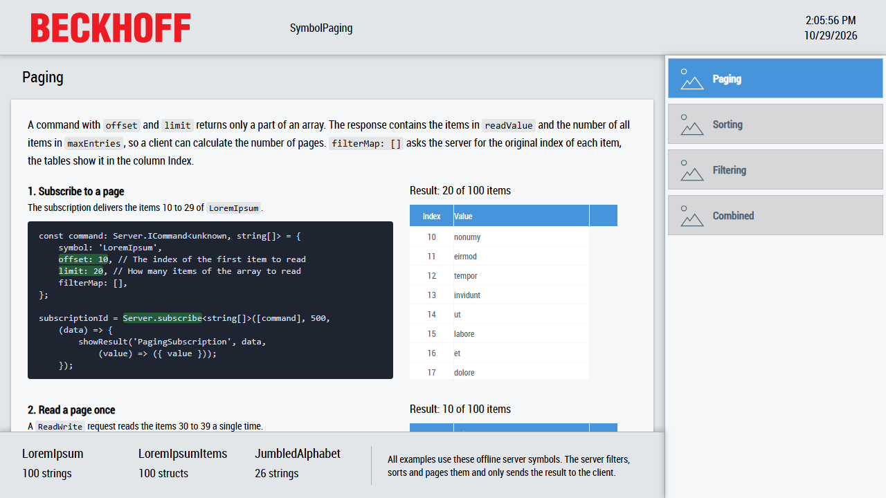

# SymbolPaging

This sample shows how a client lets the server filter, sort and page a server symbol which contains an array, so that only the requested items are sent to the client.



[Desktop.view](SymbolPaging/Desktop.view) uses the layout of the TwinCAT HMI BaseTemplate from the `Beckhoff.TwinCAT.HMI.BaseTemplate` package: a header at the top, a navigation on the right, a region for the pages in the center and a container at the bottom which lists the symbols used. There is one page per topic: `Paging`, `Sorting`, `Filtering` and `Combined`. Each page shows the relevant code next to a table with the result. The column `Index` of each table contains the original index of an item in the array.

## Scenario

The examples use three server symbols:

| Symbol            | Content                                                                                                                            |
| ----------------- | ---------------------------------------------------------------------------------------------------------------------------------- |
| `LoremIpsum`      | An array of 100 strings.                                                                                                           |
| `LoremIpsumItems` | An array of 100 structs. Each struct contains a string `text` and a struct `properties` with `length`, `hasUppercase` and `chars`. |
| `JumbledAlphabet` | An array of the 26 letters of the alphabet in random order.                                                                        |

To keep the sample lean they are offline symbols: server symbols without a mapping, defined in the `SYMBOLS` of [TcHmiSrv.Config.default.json](SymbolPaging/Server/TcHmiSrv/TcHmiSrv.Config.default.json). The server keeps their values itself, so no PLC is needed. In a real project they are typically mapped PLC arrays like `%s%PLC1.MAIN.aItems%/s%`. Filtering, sorting and paging work exactly the same for any server symbol which contains an array.

## Requesting data

Each example sends a command for one of the symbols to the server, either with a subscription or with a single request:

- `Server.subscribe` sends the result every time the value on the server changes. The code-behind subscribes when the result table is attached and calls `Server.unsubscribe` when it is detached, so the subscription only exists while the page is shown.
- `Server.request` with the request type `ReadWrite` reads the result once.

The command contains the properties which define the result. All of them can be combined:

| Property    | Meaning                                                                                 |
| ----------- | --------------------------------------------------------------------------------------- |
| `filter`    | Only the items which match are returned.                                                |
| `orderBy`   | Sorts the items.                                                                        |
| `offset`    | The index of the first item which is returned. An `offset` of 5 skips the items 0 to 4. |
| `limit`     | The maximum number of items which are returned.                                         |
| `filterMap` | An empty array asks the server to fill in the original index of each returned item.     |

The server sends the command back. `readValue` contains the items, `maxEntries` the number of items which match the filter, or the length of the array without a filter. `filterMap` contains the original indices. The function `showResult` in each code-behind writes them into the table.

## Paging

The `Paging` page subscribes to the items 10 to 29 of `LoremIpsum` and reads the items 30 to 39 once:

```ts
const command: Server.ICommand<unknown, string[]> = {
    symbol: 'LoremIpsum',
    offset: 10, // The index of the first item to read
    limit: 20, // How many items of the array to read
    filterMap: [],
};
```

With `maxEntries` a client can calculate the number of pages. See [CodeBehindPaging.ts](SymbolPaging/CodeBehindPaging.ts).

## Sorting

`orderBy` contains the path to a property followed by `ASC` for ascending or `DESC` for descending order. Arrays of strings, numbers or booleans are sorted by their values with the path `{value}`:

- `'{value} ASC'` sorts `JumbledAlphabet` alphabetically.
- `'myField DESC'` sorts structs by the field `myField`.
- `'myField::nestedValue ASC'` sorts by a field of a nested struct.
- `'myArray[2] DESC'` sorts by an item of an array.

Several criteria are separated by commas. `'properties::length DESC, text ASC'` sorts `LoremIpsumItems` by length, longest strings first, and strings with the same length alphabetically. See [CodeBehindSorting.ts](SymbolPaging/CodeBehindSorting.ts).

## Filtering

A filter consists of comparisons. Each comparison has a `path` to a property, or `{value}`, a `comparator` and a static `value` to compare against. Valid comparators are:

- `'=='` and `'!='` for strings, numbers and booleans
- `'<'`, `'>'`, `'<='` and `'>='` for numbers
- `'contains'` and `'contains not'` for strings and arrays
- `'== [ignore case]'`, `'!= [ignore case]'`, `'contains [ignore case]'` and `'contains not [ignore case]'` for strings

Comparisons are combined with `AND` or `OR` logic and can be nested to indicate precedence. Nested filters are evaluated first. A filter is written in JSON object syntax or in string syntax:

```ts
// JSON object syntax
filter: [
    { path: 'properties::hasUppercase', comparator: '==', value: true },
    { logic: 'OR' },
    [
        { path: 'properties::chars[1]', comparator: '==', value: 'o' },
        { logic: 'AND' },
        { path: 'properties::length', comparator: '>=', value: 6 },
    ],
],

// The same filter in string syntax
filter: 'properties::hasUppercase == true || (properties::chars[1] == "o" && properties::length >= 6)',
```

The `Filtering` page shows a filter by value, a filter by a property and the combined filter above in both syntaxes. See [CodeBehindFiltering.ts](SymbolPaging/CodeBehindFiltering.ts).

## Combined

The server filters the array first, then sorts the matching items and finally applies `offset` and `limit`. The `Combined` page subscribes to the items 10 to 29 of all items of `LoremIpsumItems` which start with a lowercase letter, longest strings first:

```ts
const command: Server.ICommand<unknown, LoremIpsumItem[]> = {
    symbol: 'LoremIpsumItems',
    filter: 'properties::hasUppercase == false',
    orderBy: 'properties::length DESC, text ASC',
    offset: 10,
    limit: 20,
    filterMap: [],
};
```

See [CodeBehindCombined.ts](SymbolPaging/CodeBehindCombined.ts).

## Running the sample

1. Open [SymbolPaging.sln](SymbolPaging.sln) in Visual Studio or the TwinCAT XAE Shell with TwinCAT HMI Engineering installed.
2. Restore the NuGet packages, build the solution and start the Live-View of the `SymbolPaging` project. No PLC is needed.
3. Select the pages in the navigation and compare the code with the tables.

## Files

- [SymbolPaging/Desktop.view](SymbolPaging/Desktop.view): the BaseTemplate layout with the navigation, the region which hosts the pages and the list of symbols.
- [SymbolPaging/Pages](SymbolPaging/Pages): one page per topic with the code excerpts and the result tables.
- `SymbolPaging/CodeBehind*.ts`: one code-behind file per page. They are loaded as ES modules (`dependencyFiles` in [tchmiconfig.json](SymbolPaging/Properties/tchmiconfig.json)) and fill the tables while they are attached.
- [SymbolPaging/Server/TcHmiSrv/TcHmiSrv.Config.default.json](SymbolPaging/Server/TcHmiSrv/TcHmiSrv.Config.default.json): server configuration with the offline symbols.
