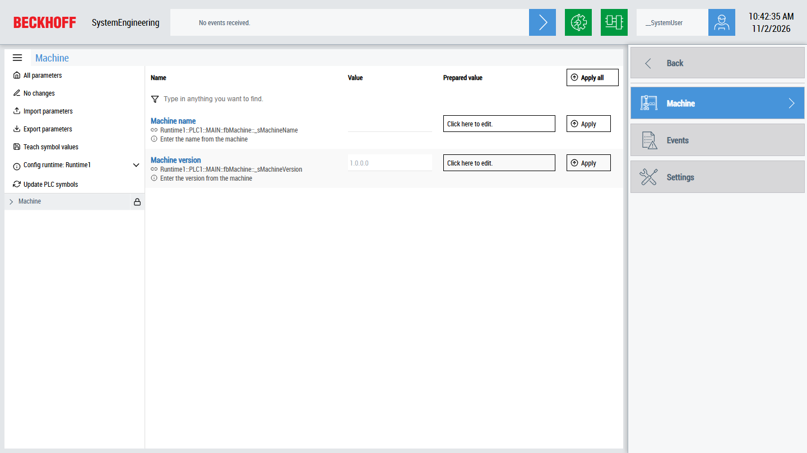

# SystemEngineering

This sample shows how the control `TcHmiParametersAndFunctions` shows and changes the parameters of a machine. The PLC marks the parameters with attributes, the server extension TcHmiSystemEngineering creates the mappings from them and persists the values.



## Running the sample

1. Open [SystemEngineering.sln](SystemEngineering.sln) in Visual Studio or the TwinCAT XAE Shell with TwinCAT HMI Engineering installed.
2. Activate the configuration of `SystemEngineering_XAE` and start the PLC.
3. Restore the NuGet packages, build the solution and start the Live-View of `SystemEngineering_HMI`.
4. If the control shows `Update PLC symbols` with the hint `Required`, click it. The extension reads the attributes of the PLC again.
5. Select `Machine` or one of the stations in the navigation and change a parameter: enter the new value in `Prepared value` and click `Apply`.

## Overview

The solution contains two projects:

| Project                                        | Content                                                                                               |
| ---------------------------------------------- | ----------------------------------------------------------------------------------------------------- |
| [SystemEngineering_HMI](SystemEngineering_HMI) | The HMI project with the server extension TcHmiSystemEngineering and the pages of the machine.        |
| [SystemEngineering_XAE](SystemEngineering_XAE) | A PLC with a machine of six stations. Their names, cylinders and settings are marked as parameters. |

[Desktop.view](SystemEngineering_HMI/Desktop.view) uses the layout of the TwinCAT HMI BaseTemplate from the `Beckhoff.TwinCAT.HMI.BaseTemplate` package: a header at the top, a navigation on the right and a region for the pages in the center. The navigation contains these pages:

| Page                                                                       | Content                                                                                      |
| -------------------------------------------------------------------------- | -------------------------------------------------------------------------------------------- |
| [Machine](SystemEngineering_HMI/Pages/Machine.content)                     | `TcHmiParametersAndFunctions` with the whole machine.                                        |
| Station 1 to 6, for example [Station1](SystemEngineering_HMI/Pages/Machine/Station1.content) | `TcHmiParametersAndFunctions` with one station of the machine.                               |
| [Events](SystemEngineering_HMI/Pages/Events.content)                       | `TcHmiEventGrid` with the alarms of the cylinders.                                           |
| [Settings](SystemEngineering_HMI/Pages/Settings.content)                   | The language and the theme of the HMI.                                                       |

## How it works

### 1. Mark the parameters in the PLC

The extension only reads variables with attributes. `MAIN.fbMachine` is the machine, it contains the stations, the stations contain the cylinders. A name makes a variable a node of the tree view in the control, an image for the node is optional:

```iecst
PROGRAM MAIN
VAR
    {attribute 'TcHmiSystemEng.Parameter.Name'          := 'Machine'}
    {attribute 'TcHmiSystemEng.Parameter.TreeViewImage' := 'Portal/normal.svg'}
    fbMachine : FB_MachineUnit;
END_VAR
```

The parameters themselves get a name, an information text and, depending on the type, limits, a unit and a group. The settings of the cylinders in [ST_CylinderConfig](SystemEngineering_XAE/SystemEngineering_PLC/POUs/02_Projecttools/Actuator/ST_CylinderConfig.TcDUT), for example:

```iecst
{attribute 'TcHmiSystemEng.Parameter.Name'      := 'Timeout'}
{attribute 'TcHmiSystemEng.Parameter.Info'      := 'Work process timout'}
{attribute 'TcHmiSystemEng.Parameter.Min'       := 'T#0S'}
{attribute 'TcHmiSystemEng.Parameter.Max'       := 'T#30S'}
{attribute 'TcHmiSystemEng.Parameter.GroupName' := 'Time'}
{attribute 'TcHmiSystemEng.Parameter.Layer'     := '-1'}
_timeout : TIME := T#5S;
```

| Attribute                                | Meaning                                                                                       |
| ---------------------------------------- | --------------------------------------------------------------------------------------------- |
| `TcHmiSystemEng.Parameter.Name`          | Name of the parameter or the node. `@this._sStationName` reads the name from a variable.    |
| `TcHmiSystemEng.Parameter.Info`          | Information text below the name.                                                              |
| `TcHmiSystemEng.Parameter.Min`, `Max`    | Limits, which the control checks before it writes the value.                                  |
| `TcHmiSystemEng.Parameter.Unit`          | Unit next to the value, for example `mm/1` or `°C`.                                           |
| `TcHmiSystemEng.Parameter.GroupName`     | Group of parameters, which can be expanded and collapsed together.                            |
| `TcHmiSystemEng.Parameter.Layer`         | Moves the parameter up in the tree. With `-1` the settings appear directly at the cylinder. |
| `TcHmiSystemEng.Parameter.TreeViewImage` | Optional image of the node in the tree view, relative to the image path of the control.      |

The attributes are described in detail in [Parameter](https://infosys.beckhoff.com/content/1033/te2000_tc3_hmi_engineering/17282744971.html) in the Beckhoff Information System.

### 2. Configure the server extension

The runtime `Runtime1` of TcHmiSystemEngineering is already configured in [TcHmiSystemEngineering.Config.default.json](SystemEngineering_HMI/Server/TcHmiSystemEngineering/TcHmiSystemEngineering.Config.default.json): the ADS runtime `PLC1`, the entry path `MAIN` and the symbol `MAIN::_isInit`, which tells the extension that the PLC is initialized. The extension persists the values of all parameters and writes them to the PLC when the server starts.

### 3. Show the parameters

The pages contain the control `TcHmiParametersAndFunctions` of the `Beckhoff.TwinCAT.HMI.SystemEngineeringUtils` package. `runtime` selects the runtime of the extension, `root-path` the part of the machine which a page shows, and `image-base-path` the folder with the images of the tree view, which depends on the theme:

```html
<div id="Station1_SystemEngineeringControl"
     data-tchmi-type="TcHmi.Controls.Beckhoff.TcHmiParametersAndFunctions"
     data-tchmi-runtime="Runtime1"
     data-tchmi-root-path="fbMachine::_fbInfeedContainer"
     data-tchmi-image-base-path="%tr%TR_SystemEngineering_ImagePath%/tr%"
     data-tchmi-show-tree-view="true">
</div>
```

The page `Machine` has no `root-path` and shows the whole machine.

## Further information

- [System Engineering](https://infosys.beckhoff.com/content/1033/te2000_tc3_hmi_engineering/17281180683.html) (documentation in Infosys)
