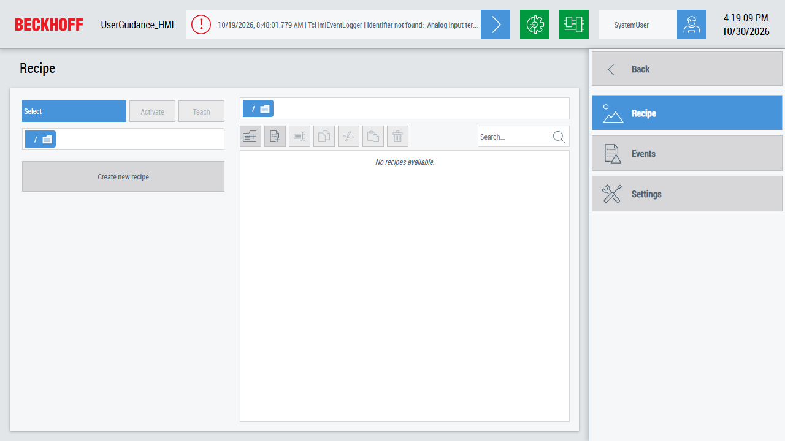

# UserGuidance

This sample shows how the control `TcHmiUserGuidance` guides the user step by step: through the creation of a new recipe and through the instructions for a message of the PLC.



## Running the sample

1. Open [UserGuidance.sln](UserGuidance.sln) in Visual Studio or the TwinCAT XAE Shell with TwinCAT HMI Engineering installed.
2. Activate the configuration of `UserGuidance_XAE` and start the PLC.
3. Restore the NuGet packages, build the solution and start the Live-View of `UserGuidance_HMI`.
4. On the page `Recipe`, click `Create new recipe` and follow the steps. The new recipe appears in the recipe list on the right.
5. Set `MAIN.bSendMessagePDF` or `MAIN.bSendMessageMP4` of the PLC to `TRUE`, for example in the online view of `MAIN`. Then double-click the message on the page `Events`.

## Overview

The solution contains two projects:

| Project                              | Content                                                                                                     |
| ------------------------------------ | ----------------------------------------------------------------------------------------------------------- |
| [UserGuidance_HMI](UserGuidance_HMI) | The HMI project with the recipe management, the event logger and the user controls of both user guidances. |
| [UserGuidance_XAE](UserGuidance_XAE) | A PLC which sends the messages `Event_PDF` and `Event_MP4` of the event class `TestEvents`.                 |

[Desktop.view](UserGuidance_HMI/Desktop.view) uses the layout of the TwinCAT HMI BaseTemplate from the `Beckhoff.TwinCAT.HMI.BaseTemplate` package: a header at the top, a navigation on the right and a region for the pages in the center. The navigation contains these pages:

| Page                                               | Content                                                                                                          |
| -------------------------------------------------- | ---------------------------------------------------------------------------------------------------------------- |
| [Recipe](UserGuidance_HMI/Pages/Recipe.content)     | `TcHmiRecipeSelect` and `TcHmiRecipeEdit` and the button which opens the user guidance for a new recipe.         |
| [Events](UserGuidance_HMI/Pages/Events.content)     | `TcHmiEventGrid` with the messages. A double-click opens the user guidance for the message.                     |
| [Settings](UserGuidance_HMI/Pages/Settings.content) | The language and the theme of the HMI.                                                                           |

## How it works

`TcHmiUserGuidance` shows a sequence of pages with a progress bar and buttons to go back and forth. Each page is a user control. Both user guidances of the sample run in a popup and set their pages at runtime with `setPages`, so the steps can depend on the data.

### Create a new recipe

[UserGuidanceRecipe](UserGuidance_HMI/UserControls/UserGuidanceRecipe.usercontrol) has three steps. A trigger on the recipe type sets the pages: the second and the third step are only added when a recipe type is selected.

| Step                                                                | Content                                               |
| ------------------------------------------------------------------- | ----------------------------------------------------- |
| [RecipeInfo](UserGuidance_HMI/UserControls/RecipeInfo.usercontrol)         | Name and recipe type of the new recipe.               |
| [RecipeProduct](UserGuidance_HMI/UserControls/RecipeProduct.usercontrol)   | Type, color and amount of the bottles.                |
| [RecipeOverview](UserGuidance_HMI/UserControls/RecipeOverview.usercontrol) | Summary of all values before the recipe is created.  |

When the user clicks the finish button, the user guidance creates the recipe with the Framework API and closes the popup:

```js
TcHmi.Server.RecipeManagement.createRecipeEx(
    recipeData.Name,
    null,
    {
        recipeTypeName: recipeData.RecipeType,
        values: {
            RecipeBottleType: recipeData.Type,
            RecipeBottleAmount: recipeData.Amount,
            RecipeBottleColor: recipeData.Color
        }
    },
    null,
    { timeout: 2000 },
    function (data) { /* ... */ }
);
```

### Explain a message

[UserGuidanceEvent](UserGuidance_HMI/UserControls/UserGuidanceEvent.usercontrol) shows the message in [EventInfos](UserGuidance_HMI/UserControls/EventInfos.usercontrol) first. The second step depends on the `DescriptionUrl` of the message, which the event class `TestEvents` in [UserGuidance_XAE.tsproj](UserGuidance_XAE/UserGuidance_XAE.tsproj) defines:

| Message     | DescriptionUrl                           | Second step                                                                                        |
| ----------- | ---------------------------------------- | -------------------------------------------------------------------------------------------------- |
| `Event_PDF` | `/Imports/PDF/Beckhoff_TwinCAT_HMI_e.pdf` | [EventErrorInstructionsPDF](UserGuidance_HMI/UserControls/EventErrorInstructionsPDF.usercontrol) with a PDF viewer |
| `Event_MP4` | `/Imports/Videos/NavigationTemplates.mp4` | [EventErrorInstructionsMP4](UserGuidance_HMI/UserControls/EventErrorInstructionsMP4.usercontrol) with a video      |

The files are part of the HMI project in [Imports](UserGuidance_HMI/Imports).

## Further information

- [TE2000 TwinCAT 3 HMI Engineering](https://infosys.beckhoff.com/content/1033/te2000_tc3_hmi_engineering/index.html) (documentation in Infosys, see the controls and the recipe management)
